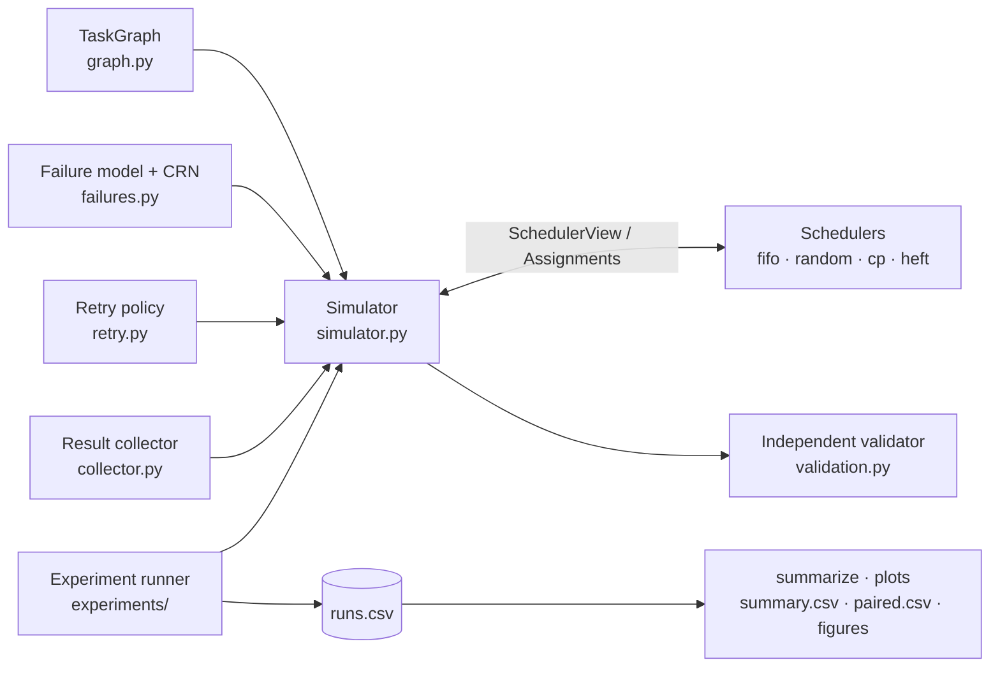

# dagsched — fault-tolerant scheduling of multi-agent task graphs

A discrete-event simulator, scheduling policies and reproducible experiments for running
dependent tasks on parallel, failure-prone workers.

[](https://github.com/echchakarhaitam-cyber/multiagent-dag-scheduler/actions/workflows/ci.yml)
[](LICENSE)

## Executive summary

dagsched simulates task graphs (DAGs) executed by k workers with different speeds, under
random task failures, retries with backoff and duplicate result delivery. It compares four
online schedulers (FIFO, random, critical-path, HEFT-style) on 6 synthetic graph families
× 30 instances, with paired designs, bootstrap CIs and Holm-corrected sign tests. On these
graphs:
- critical-path scheduling lowered the mean normalized makespan vs FIFO by up to 0.151;
- the HEFT-style scheduler beat critical-path scheduling in 10 of 12 heterogeneous settings;
- idempotent collection kept every run valid, while naive collection produced invalid
  schedules in 58–99% of runs;
- common random numbers reduced the variance of paired differences 1.86–43.90×.

## Problem statement

A task graph G = (V, E) is a DAG. Each task v ∈ V has a duration w(v) > 0, and an edge
u → v means v may start only after u has finished. k workers have speeds s₁ … s_k > 0, and
task v takes w(v)/s_j on worker j. Execution is non-preemptive, one task per worker at a time,
and there are no communication costs. The objective is the makespan, i.e. the completion
time of the last task. Minimizing the makespan with precedence constraints is NP-hard in
general, even on identical machines, so this project evaluates heuristics empirically and
reports each result relative to the lower bound LB = max(CP / s_max, W / Σ s_j), where CP is
the critical-path length and W the total work.

## Motivation

Multi-agent and LLM-agent systems decompose a goal into dependent subtasks that run on
parallel workers. In practice those workers fail, are retried, and sometimes report the same
result twice. This project grew out of hands-on work on agent orchestration during an
internship, and studies these effects in a controlled, independent setting with textbook
algorithms and synthetic workloads.

## Architecture



| Module | Responsibility |
|---|---|
| `graph.py` | Validated immutable DAG, Kahn order, bottom/top levels, critical path |
| `simulator.py` | Event-driven execution, decision points, failures, retries, duplicates |
| `schedulers/` | FIFO, random, critical-path (HLF), online HEFT-style, name registry |
| `failures.py`, `retry.py`, `collector.py` | Failure models, backoff policy, idempotent collection |
| `bounds.py`, `validation.py` | Makespan lower bound; schedule checker independent of the simulator |
| `generators.py`, `stats.py` | Seeded synthetic DAGs; bootstrap CI, sign test, Holm correction |
| `experiments/` | JSON configs, paired runner, summaries, plots, ablations, CLI |
| `scripts/` | Result sanity checks, table generation for the docs |

## Algorithms

- **Kahn's topological order** with a min-heap, so ties go to the smallest id;
  O((V+E) log V), iterative. See [01-task-graphs](docs/theory/01-task-graphs.md).
- **Bottom and top levels, critical path, lower bound** max(CP, W/k), and the heterogeneous
  form above. See [01](docs/theory/01-task-graphs.md) and
  [03](docs/theory/03-schedulers.md).
- **FIFO and Random:** work-conserving list schedulers, within Graham's 2 − 1/k factor on
  identical workers. See [02-simulation](docs/theory/02-simulation.md).
- **Critical path / Highest Level First** (Hu): largest bottom level first, fastest worker
  first.
- **Online HEFT-style:** upward rank with mean costs, earliest-finish-time placement, and
  deliberate idling of slow workers. It is identical to cp on identical workers (proof in
  [03](docs/theory/03-schedulers.md)).
- **Failures, common random numbers, retries and backoff:** Bernoulli attempt failures, with
  draws shared by all schedulers, and exponential backoff then cancellation of descendants.
  See [04-failures](docs/theory/04-failures.md).
- **Idempotent collection:** at-least-once delivery with an exactly-once effect. See
  [04](docs/theory/04-failures.md).

## Technologies

Python ≥ 3.10. The core library uses only the standard library. pytest and ruff are used for
development, matplotlib only for plots (optional extra `experiments`), and GitHub Actions for
CI (Ubuntu and Windows × Python 3.10–3.12).

## Installation

Windows (PowerShell):
```powershell
git clone https://github.com/echchakarhaitam-cyber/multiagent-dag-scheduler.git
cd multiagent-dag-scheduler
python -m venv .venv; .venv\Scripts\Activate.ps1
pip install -e ".[dev]"          # ".[dev,experiments]" to also draw figures
```
macOS / Linux:
```bash
git clone https://github.com/echchakarhaitam-cyber/multiagent-dag-scheduler.git
cd multiagent-dag-scheduler
python3 -m venv .venv && source .venv/bin/activate
pip install -e ".[dev]"          # ".[dev,experiments]" to also draw figures
```

## Quick start

```python
from dagsched import CriticalPathScheduler, FIFOScheduler, Task, TaskGraph, Worker
from dagsched import lower_bound, simulate, validate_schedule

graph = TaskGraph([Task("A", 2), Task("B", 3, ["A"]), Task("C", 1, ["A"]),
                   Task("D", 4, ["B", "C"]), Task("E", 2, ["C"]), Task("F", 1, ["D", "E"])])
workers = [Worker("W0"), Worker("W1")]
print("lower bound:", lower_bound(graph, workers))
for scheduler in (FIFOScheduler(), CriticalPathScheduler()):
    result = simulate(graph, workers, scheduler)
    validate_schedule(graph, workers, result)
    print(scheduler.name, result.makespan, [(r.task_id, r.worker_id, r.start) for r in result.records])
```
Output:
```
lower bound: 10.0
fifo 10.0 [('A', 'W0', 0.0), ('B', 'W0', 2.0), ('C', 'W1', 2.0), ('E', 'W1', 3.0), ('D', 'W0', 5.0), ('F', 'W0', 9.0)]
cp 10.0 [('A', 'W0', 0.0), ('B', 'W0', 2.0), ('C', 'W1', 2.0), ('E', 'W1', 3.0), ('D', 'W0', 5.0), ('F', 'W0', 9.0)]
```
On this small graph both schedulers reach the lower bound. Examples where they differ are in
[03-schedulers](docs/theory/03-schedulers.md).

## Reproducing the experiments

```
python -m dagsched.experiments run configs/e1_homogeneous.json --out results/e1   # also e2, e3
python -m dagsched.experiments summarize results/e1                             # per experiment
python -m dagsched.experiments summarize results/e2 --baseline cp --paired-out paired_vs_cp.csv
python -m dagsched.experiments summarize results/e3 --baseline cp --paired-out paired_vs_cp.csv
python -m dagsched.experiments plot results/e1 --out docs/figures               # needs matplotlib
python -m dagsched.experiments ablation idempotency --out results/a1
python -m dagsched.experiments ablation crn --out results/a2
python scripts/check_results.py && python scripts/make_results_tables.py && python scripts/make_results_tables.py --readme
```
Rerunning a config reproduces its `runs.csv` byte for byte. Measured wall times:

<!-- BEGIN GENERATED: readme_walltimes -->
Source: `results/*/metadata.json` (one run on the development laptop).

| experiment | definition | runs | wall time (s) |
|---|---|---|---|
| E1 | `configs/e1_homogeneous.json` | 2880 | 16.9 |
| E2 | `configs/e2_heterogeneous.json` | 1440 | 8.4 |
| E3 | `configs/e3_failures.json` | 7200 | 59.6 |
| A1 | `ablation idempotency` | 2880 | 21.5 |
| A2 | `ablation crn` | 14400 | 139.6 |
<!-- END GENERATED: readme_walltimes -->

## Results

Headline tables only. All tables, paired tests and observations are in
[docs/results.md](docs/results.md); every number is generated from committed CSV files.
*Normalized makespan* = makespan / lower bound (1 = bound reached). Holm p < 0.05 with a CI
excluding 0 counts as significant.

**RQ1, homogeneous workers.** cp and heft are identical here (proven).

<!-- BEGIN GENERATED: readme_rq1 -->
E1, k = 4, mean normalized makespan (all k: docs/results.md). Source: `results/e1/summary.csv`, `paired.csv`.

| graph | durations | fifo | random | cp = heft | cp − fifo [CI], Holm p |
|---|---|---|---|---|---|
| layered | uniform | 1.023 | 1.036 | 1.005 | -0.018 [-0.021, -0.014], p_H <0.001 |
| layered | lognormal | 1.114 | 1.118 | 1.010 | -0.103 [-0.126, -0.081], p_H <0.001 |
| erdos_renyi | uniform | 1.045 | 1.055 | 1.005 | -0.040 [-0.051, -0.030], p_H <0.001 |
| erdos_renyi | lognormal | 1.104 | 1.114 | 1.003 | -0.101 [-0.126, -0.077], p_H <0.001 |
| fork_join | uniform | 1.316 | 1.319 | 1.189 | -0.127 [-0.137, -0.117], p_H <0.001 |
| fork_join | lognormal | 1.076 | 1.097 | 1.012 | -0.065 [-0.079, -0.051], p_H <0.001 |
<!-- END GENERATED: readme_rq1 -->


**RQ2, heterogeneous workers (speeds U[0.5, 2]).**

<!-- BEGIN GENERATED: readme_rq2 -->
E2, k = 8 heterogeneous workers, mean normalized makespan (k = 4: docs/results.md). Source: `results/e2/summary.csv`, `paired_vs_cp.csv`.

| graph | durations | fifo | cp | heft | heft − cp [CI], Holm p |
|---|---|---|---|---|---|
| layered | uniform | 1.501 | 1.222 | 1.107 | -0.115 [-0.137, -0.095], p_H <0.001 |
| layered | lognormal | 1.767 | 1.178 | 1.095 | -0.083 [-0.130, -0.040], p_H 0.143 |
| erdos_renyi | uniform | 1.272 | 1.121 | 1.012 | -0.110 [-0.140, -0.082], p_H <0.001 |
| erdos_renyi | lognormal | 1.533 | 1.271 | 1.030 | -0.241 [-0.369, -0.141], p_H <0.001 |
| fork_join | uniform | 1.992 | 1.129 | 1.117 | -0.012 [-0.023, -0.004], p_H 0.047 |
| fork_join | lognormal | 1.810 | 1.013 | 1.013 | -0.000 [-0.000, +0.000], p_H 1.000 |
<!-- END GENERATED: readme_rq2 -->


**RQ3, failures (Bernoulli p per attempt, ≤ 5 attempts, duplicates with idempotent collection).**

<!-- BEGIN GENERATED: readme_rq3 -->
E3, k = 4, mean normalized makespan of completed runs (all p and paired tests: docs/results.md). Source: `results/e3/summary.csv`.

| workers | graph | durations | fifo (p 0.0 → 0.3) | cp (p 0.0 → 0.3) | heft (p 0.0 → 0.3) | completion at p = 0.3 |
|---|---|---|---|---|---|---|
| homogeneous | layered | uniform | 1.023 → 1.334 | 1.005 → 1.288 | 1.005 → 1.288 | 0.73 |
| homogeneous | layered | lognormal | 1.114 → 1.423 | 1.010 → 1.340 | 1.010 → 1.340 | 0.77 |
| homogeneous | erdos_renyi | uniform | 1.045 → 1.289 | 1.005 → 1.234 | 1.005 → 1.234 | 0.80 |
| homogeneous | erdos_renyi | lognormal | 1.104 → 1.345 | 1.003 → 1.255 | 1.003 → 1.255 | 0.73 |
| homogeneous | fork_join | uniform | 1.316 → 1.795 | 1.189 → 1.721 | 1.189 → 1.721 | 0.93 |
| homogeneous | fork_join | lognormal | 1.076 → 1.508 | 1.012 → 1.485 | 1.012 → 1.485 | 0.97 |
| heterogeneous | layered | uniform | 1.038 → 1.378 | 1.020 → 1.303 | 1.005 → 1.299 | 0.73 |
| heterogeneous | layered | lognormal | 1.218 → 1.545 | 1.200 → 1.415 | 1.010 → 1.354 | 0.77 |
| heterogeneous | erdos_renyi | uniform | 1.062 → 1.327 | 1.009 → 1.237 | 1.004 → 1.236 | 0.80 |
| heterogeneous | erdos_renyi | lognormal | 1.129 → 1.391 | 1.064 → 1.276 | 1.002 → 1.254 | 0.73 |
| heterogeneous | fork_join | uniform | 1.733 → 2.415 | 1.373 → 1.954 | 1.312 → 1.903 | 0.93 |
| heterogeneous | fork_join | lognormal | 1.654 → 2.317 | 1.138 → 1.780 | 1.107 → 1.743 | 0.97 |
<!-- END GENERATED: readme_rq3 -->


**RQ4, is idempotent collection necessary?**

<!-- BEGIN GENERATED: readme_rq4 -->
A1, fraction of runs with an invalid schedule [95% CI], 180 runs per cell. Source: `results/a1/summary.csv`.

| duplicate prob. q | idempotent, fifo | idempotent, cp | naive, fifo | naive, cp |
|---|---|---|---|---|
| 0.0 | 0.000 [0.000, 0.000] | 0.000 [0.000, 0.000] | 0.000 [0.000, 0.000] | 0.000 [0.000, 0.000] |
| 0.05 | 0.000 [0.000, 0.000] | 0.000 [0.000, 0.000] | 0.822 [0.761, 0.878] | 0.583 [0.511, 0.656] |
| 0.1 | 0.000 [0.000, 0.000] | 0.000 [0.000, 0.000] | 0.950 [0.917, 0.978] | 0.778 [0.711, 0.839] |
| 0.2 | 0.000 [0.000, 0.000] | 0.000 [0.000, 0.000] | 0.989 [0.972, 1.000] | 0.856 [0.800, 0.906] |
<!-- END GENERATED: readme_rq4 -->

**RQ5, how much variance do common random numbers (CRN) remove?**

<!-- BEGIN GENERATED: readme_rq5 -->
A2, var(d) without CRN / var(d) with CRN for d = cp − fifo, 300 pairs per cell. Source: `results/a2/summary.csv`.

| graph | durations | var ratio, p = 0.1 [CI] | var ratio, p = 0.2 [CI] |
|---|---|---|---|
| layered | uniform | 2.76 [1.91, 4.02] | 8.07 [2.63, 19.91] |
| layered | lognormal | 4.76 [3.42, 6.40] | 11.97 [8.74, 15.73] |
| erdos_renyi | uniform | 1.86 [1.35, 2.54] | 2.79 [1.90, 4.12] |
| erdos_renyi | lognormal | 2.04 [1.48, 2.93] | 2.38 [1.74, 3.25] |
| fork_join | uniform | 6.54 [5.08, 8.38] | 20.43 [15.34, 26.63] |
| fork_join | lognormal | 15.26 [11.60, 19.70] | 43.90 [33.34, 58.24] |
<!-- END GENERATED: readme_rq5 -->

## Validation and testing

- Every simulated run is checked by an **independent validator**: precedence, durations, no
  overlaps, attempt sequences, cancellations and aggregates. An invalid schedule aborts an
  experiment.
- `scripts/check_results.py` verifies normalized makespan ≥ 1, Graham's 2 − 1/k bound on E1,
  completion rates, and that partial runs never depend on the scheduler.
- Randomized tests on 50 seeded DAGs check validity, the lower bound and Graham's bound for
  every scheduler, plus determinism (same seed, identical result).
- Hand-computed schedules are pinned in tests, and reruns are byte-identical.
- `pytest -q`: 478 passed with the `experiments` extra installed; in a fresh `.[dev]`-only
  install the 4 plot tests are skipped (474 passed, 4 skipped).

## Limitations

Synthetic graphs only, with one size per family. There are no communication costs.
Failures are independent Bernoulli events, detected instantly, and there are no worker
crashes or timeouts. `heft` is an online adaptation, not the static HEFT algorithm. There is
one simulation seed per instance in E1–E3. The lower bound is not tight (fork–join at small
k). Means under failures are conditional on completion. Holm correction is applied within
each results file only. See [Threats to validity](docs/results.md#threats-to-validity).

## Future work

- Communication costs between dependent tasks on different workers.
- LLM-based task decomposition with a local model, to produce realistic task graphs.
- Worker crashes and timeouts whose outcome is unknown, beyond independent attempt failures.
- Real agent execution traces instead of synthetic graphs.
- Learned scheduling policies, compared against the baselines here.

## References

- R. L. Graham, "Bounds on Multiprocessing Timing Anomalies", *SIAM J. Appl. Math.* 17(2),
  1969. DOI 10.1137/0117039.
- T. C. Hu, "Parallel Sequencing and Assembly Line Problems", *Operations Research* 9(6),
  1961. (The exact optimality statement cited in the docs is marked "to verify".)
- H. Topcuoglu, S. Hariri, M.-Y. Wu, "Performance-Effective and Low-Complexity Task
  Scheduling for Heterogeneous Computing", *IEEE TPDS* 13(3), 2002.
- J. D. Ullman, NP-completeness of scheduling with precedence constraints, 1975 (to verify).

## License and citation

MIT, see [LICENSE](LICENSE). To cite this software, use [CITATION.cff](CITATION.cff)
(Haitam Echchakar, 2026). The documentation index is [docs/README.md](docs/README.md).
