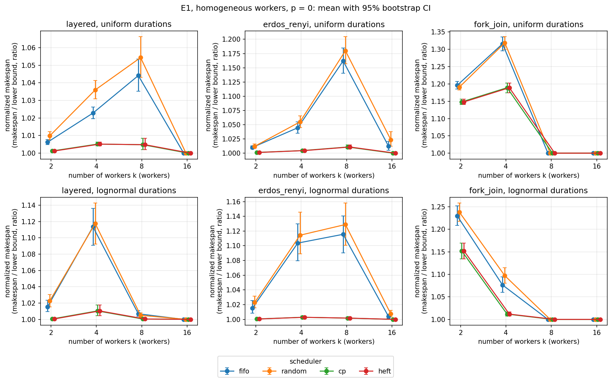
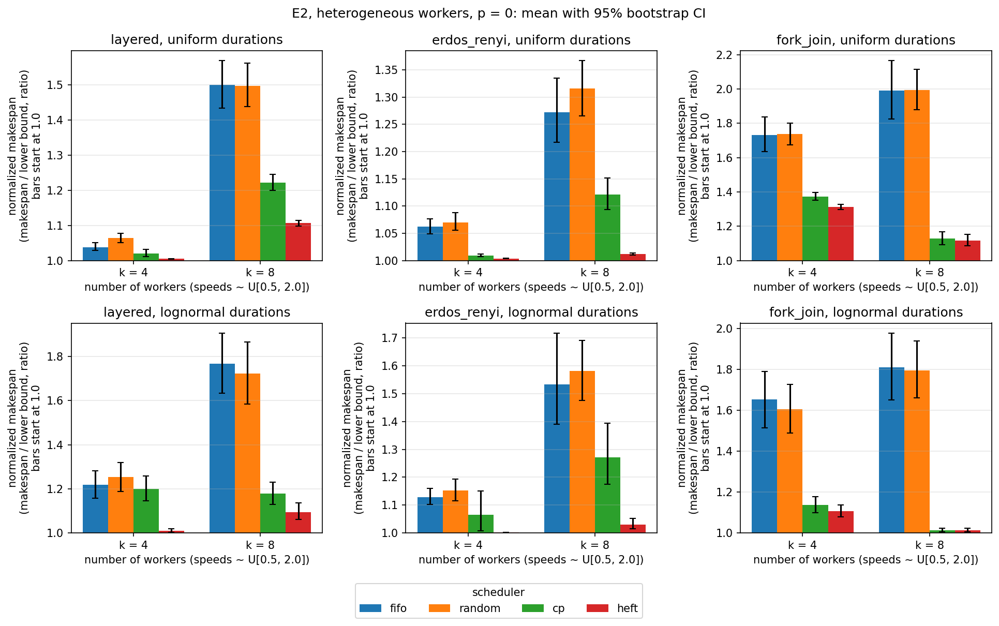
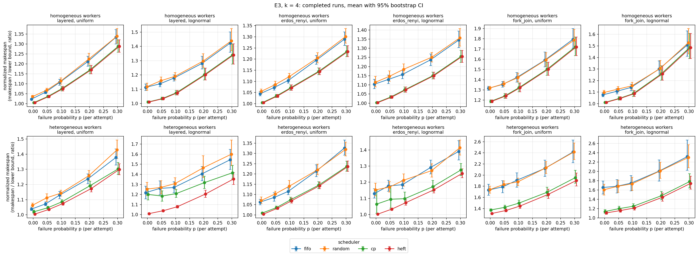
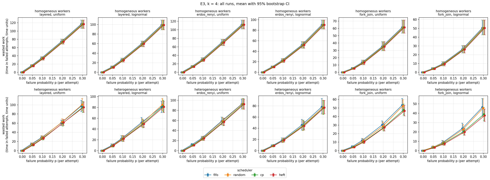

# Results: experiments E1–E3

All numbers in this document are produced by `scripts/make_results_tables.py` from the
committed files `results/e{1,2,3}/summary.csv`, `paired.csv` and `metadata.json` (values are
rounded for display). The blocks between `<!-- BEGIN GENERATED -->` markers must not be edited
by hand; `python scripts/make_results_tables.py --check` verifies they are up to date.
Methodology: [docs/experiments.md](experiments.md).

## Reproducing

```
python -m dagsched.experiments run configs/e1_homogeneous.json --out results/e1
python -m dagsched.experiments run configs/e2_heterogeneous.json --out results/e2
python -m dagsched.experiments run configs/e3_failures.json --out results/e3
python -m dagsched.experiments summarize results/eX           # for X = 1, 2, 3
python -m dagsched.experiments plot results/eX --out docs/figures
python scripts/check_results.py
python scripts/make_results_tables.py
```

Common setup: 6 graph specifications (layered: 100 tasks, 10 layers, edge probability 0.2;
Erdős–Rényi: 100 tasks, edge probability 0.05; fork–join: width 8, 6 stages; each with
durations uniform on [1, 10] and lognormal(μ = 1, σ = 1) clipped at 0.1), 30 graph seeds
(0–29), one simulation seed, schedulers fifo, random, cp, heft. Every run was validated by the
independent schedule validator and `scripts/check_results.py` passed (all completed runs have
normalized makespan ≥ 1, E1 respects Graham's 2 − 1/k bound, E1/E2 completion rate 1.0).

How to read the tables:
- *normalized makespan* = makespan / lower bound (≥ 1; 1 means the lower bound was reached),
  shown as mean [95% bootstrap CI] over the 30 graph instances (completed runs only);
- paired tables: Δ = normalized makespan(scheduler) − normalized makespan(fifo) on the same
  instance, as mean [95% bootstrap CI]; *win* = fraction of instances with Δ < 0;
  *p_H* = sign-test p-value, Holm-adjusted over all comparisons of the experiment;
  **sig.** marks p_H < 0.05 **and** a CI excluding 0. Anything else is not significant.

## RQ1: homogeneous workers (E1)

How do fifo, random, cp and heft compare across graph families and numbers of workers k?

<!-- BEGIN GENERATED: setup_e1 -->
- Config: `configs/e1_homogeneous.json`; 2880 runs; wall time 16.9 s; commit `fe26dcb` (dirty: False); Python 3.10.11.
- Source: `results/e1/metadata.json`
<!-- END GENERATED: setup_e1 -->
- Workers: k ∈ {2, 4, 8, 16}, all speed 1; no failures (p = 0).

Mean normalized makespan [95% CI]:

<!-- BEGIN GENERATED: e1_makespan -->
Source: `results/e1/summary.csv`

| graph | durations | k | fifo | random | cp | heft |
|---|---|---|---|---|---|---|
| layered | uniform | 2 | 1.006 [1.005, 1.008] | 1.010 [1.007, 1.012] | 1.001 [1.001, 1.002] | 1.001 [1.001, 1.002] |
| layered | uniform | 4 | 1.023 [1.020, 1.026] | 1.036 [1.031, 1.041] | 1.005 [1.004, 1.006] | 1.005 [1.004, 1.006] |
| layered | uniform | 8 | 1.044 [1.035, 1.053] | 1.054 [1.043, 1.066] | 1.005 [1.002, 1.008] | 1.005 [1.002, 1.008] |
| layered | uniform | 16 | 1.000 [1.000, 1.000] | 1.000 [1.000, 1.000] | 1.000 [1.000, 1.000] | 1.000 [1.000, 1.000] |
| layered | lognormal | 2 | 1.016 [1.010, 1.023] | 1.023 [1.015, 1.031] | 1.001 [1.000, 1.001] | 1.001 [1.000, 1.001] |
| layered | lognormal | 4 | 1.114 [1.091, 1.136] | 1.118 [1.092, 1.143] | 1.010 [1.005, 1.018] | 1.010 [1.005, 1.018] |
| layered | lognormal | 8 | 1.007 [1.004, 1.011] | 1.005 [1.002, 1.008] | 1.000 [1.000, 1.001] | 1.000 [1.000, 1.001] |
| layered | lognormal | 16 | 1.000 [1.000, 1.000] | 1.000 [1.000, 1.000] | 1.000 [1.000, 1.000] | 1.000 [1.000, 1.000] |
| erdos_renyi | uniform | 2 | 1.010 [1.008, 1.013] | 1.012 [1.009, 1.016] | 1.001 [1.001, 1.002] | 1.001 [1.001, 1.002] |
| erdos_renyi | uniform | 4 | 1.045 [1.035, 1.055] | 1.055 [1.045, 1.066] | 1.005 [1.004, 1.006] | 1.005 [1.004, 1.006] |
| erdos_renyi | uniform | 8 | 1.162 [1.141, 1.185] | 1.180 [1.157, 1.204] | 1.011 [1.008, 1.014] | 1.011 [1.008, 1.014] |
| erdos_renyi | uniform | 16 | 1.012 [1.005, 1.020] | 1.024 [1.012, 1.038] | 1.000 [1.000, 1.000] | 1.000 [1.000, 1.000] |
| erdos_renyi | lognormal | 2 | 1.015 [1.008, 1.026] | 1.023 [1.016, 1.031] | 1.001 [1.000, 1.001] | 1.001 [1.000, 1.001] |
| erdos_renyi | lognormal | 4 | 1.104 [1.079, 1.130] | 1.114 [1.089, 1.146] | 1.003 [1.002, 1.005] | 1.003 [1.002, 1.005] |
| erdos_renyi | lognormal | 8 | 1.116 [1.090, 1.141] | 1.129 [1.101, 1.158] | 1.002 [1.000, 1.003] | 1.002 [1.000, 1.003] |
| erdos_renyi | lognormal | 16 | 1.004 [1.001, 1.007] | 1.007 [1.003, 1.012] | 1.000 [1.000, 1.000] | 1.000 [1.000, 1.000] |
| fork_join | uniform | 2 | 1.196 [1.185, 1.207] | 1.191 [1.182, 1.200] | 1.148 [1.141, 1.156] | 1.148 [1.141, 1.156] |
| fork_join | uniform | 4 | 1.316 [1.295, 1.336] | 1.319 [1.299, 1.336] | 1.189 [1.174, 1.203] | 1.189 [1.174, 1.203] |
| fork_join | uniform | 8 | 1.000 [1.000, 1.000] | 1.000 [1.000, 1.000] | 1.000 [1.000, 1.000] | 1.000 [1.000, 1.000] |
| fork_join | uniform | 16 | 1.000 [1.000, 1.000] | 1.000 [1.000, 1.000] | 1.000 [1.000, 1.000] | 1.000 [1.000, 1.000] |
| fork_join | lognormal | 2 | 1.230 [1.208, 1.252] | 1.238 [1.218, 1.259] | 1.152 [1.135, 1.170] | 1.152 [1.135, 1.170] |
| fork_join | lognormal | 4 | 1.076 [1.060, 1.094] | 1.097 [1.080, 1.115] | 1.012 [1.007, 1.017] | 1.012 [1.007, 1.017] |
| fork_join | lognormal | 8 | 1.000 [1.000, 1.000] | 1.000 [1.000, 1.000] | 1.000 [1.000, 1.000] | 1.000 [1.000, 1.000] |
| fork_join | lognormal | 16 | 1.000 [1.000, 1.000] | 1.000 [1.000, 1.000] | 1.000 [1.000, 1.000] | 1.000 [1.000, 1.000] |
<!-- END GENERATED: e1_makespan -->

Paired difference to fifo:

<!-- BEGIN GENERATED: e1_paired -->
Source: `results/e1/paired.csv`

| graph | durations | k | random | cp | heft |
|---|---|---|---|---|---|
| layered | uniform | 2 | +0.004 [+0.001, +0.007]; win 0.30; p_H 1.000 | -0.005 [-0.007, -0.004]; win 0.87; p_H 0.002 **sig.** | -0.005 [-0.007, -0.004]; win 0.87; p_H 0.002 **sig.** |
| layered | uniform | 4 | +0.013 [+0.007, +0.019]; win 0.20; p_H 0.054 | -0.018 [-0.021, -0.014]; win 0.97; p_H <0.001 **sig.** | -0.018 [-0.021, -0.014]; win 0.97; p_H <0.001 **sig.** |
| layered | uniform | 8 | +0.010 [+0.000, +0.020]; win 0.33; p_H 1.000 | -0.039 [-0.048, -0.031]; win 1.00; p_H <0.001 **sig.** | -0.039 [-0.048, -0.031]; win 1.00; p_H <0.001 **sig.** |
| layered | uniform | 16 | +0.000 [+0.000, +0.000]; win 0.00; p_H 1.000 | +0.000 [+0.000, +0.000]; win 0.00; p_H 1.000 | +0.000 [+0.000, +0.000]; win 0.00; p_H 1.000 |
| layered | lognormal | 2 | +0.007 [-0.003, +0.017]; win 0.47; p_H 1.000 | -0.015 [-0.023, -0.009]; win 0.97; p_H <0.001 **sig.** | -0.015 [-0.023, -0.009]; win 0.97; p_H <0.001 **sig.** |
| layered | lognormal | 4 | +0.004 [-0.011, +0.019]; win 0.50; p_H 1.000 | -0.103 [-0.126, -0.081]; win 1.00; p_H <0.001 **sig.** | -0.103 [-0.126, -0.081]; win 1.00; p_H <0.001 **sig.** |
| layered | lognormal | 8 | -0.002 [-0.004, +0.001]; win 0.40; p_H 1.000 | -0.006 [-0.009, -0.004]; win 0.57; p_H <0.001 **sig.** | -0.006 [-0.009, -0.004]; win 0.57; p_H <0.001 **sig.** |
| layered | lognormal | 16 | +0.000 [+0.000, +0.000]; win 0.00; p_H 1.000 | +0.000 [+0.000, +0.000]; win 0.00; p_H 1.000 | +0.000 [+0.000, +0.000]; win 0.00; p_H 1.000 |
| erdos_renyi | uniform | 2 | +0.002 [-0.002, +0.006]; win 0.50; p_H 1.000 | -0.009 [-0.012, -0.006]; win 0.97; p_H <0.001 **sig.** | -0.009 [-0.012, -0.006]; win 0.97; p_H <0.001 **sig.** |
| erdos_renyi | uniform | 4 | +0.010 [+0.001, +0.019]; win 0.30; p_H 1.000 | -0.040 [-0.051, -0.030]; win 1.00; p_H <0.001 **sig.** | -0.040 [-0.051, -0.030]; win 1.00; p_H <0.001 **sig.** |
| erdos_renyi | uniform | 8 | +0.018 [+0.005, +0.031]; win 0.23; p_H 0.193 | -0.151 [-0.174, -0.129]; win 1.00; p_H <0.001 **sig.** | -0.151 [-0.174, -0.129]; win 1.00; p_H <0.001 **sig.** |
| erdos_renyi | uniform | 16 | +0.011 [+0.003, +0.021]; win 0.23; p_H 1.000 | -0.012 [-0.020, -0.005]; win 0.47; p_H 0.005 **sig.** | -0.012 [-0.020, -0.005]; win 0.47; p_H 0.005 **sig.** |
| erdos_renyi | lognormal | 2 | +0.008 [+0.001, +0.014]; win 0.40; p_H 1.000 | -0.015 [-0.025, -0.008]; win 1.00; p_H <0.001 **sig.** | -0.015 [-0.025, -0.008]; win 1.00; p_H <0.001 **sig.** |
| erdos_renyi | lognormal | 4 | +0.011 [-0.008, +0.028]; win 0.37; p_H 1.000 | -0.101 [-0.126, -0.077]; win 1.00; p_H <0.001 **sig.** | -0.101 [-0.126, -0.077]; win 1.00; p_H <0.001 **sig.** |
| erdos_renyi | lognormal | 8 | +0.013 [-0.006, +0.033]; win 0.50; p_H 1.000 | -0.114 [-0.139, -0.089]; win 1.00; p_H <0.001 **sig.** | -0.114 [-0.139, -0.089]; win 1.00; p_H <0.001 **sig.** |
| erdos_renyi | lognormal | 16 | +0.004 [-0.000, +0.008]; win 0.10; p_H 1.000 | -0.004 [-0.007, -0.001]; win 0.23; p_H 0.547 | -0.004 [-0.007, -0.001]; win 0.23; p_H 0.547 |
| fork_join | uniform | 2 | -0.005 [-0.016, +0.006]; win 0.57; p_H 1.000 | -0.048 [-0.056, -0.040]; win 1.00; p_H <0.001 **sig.** | -0.048 [-0.056, -0.040]; win 1.00; p_H <0.001 **sig.** |
| fork_join | uniform | 4 | +0.003 [-0.014, +0.019]; win 0.57; p_H 1.000 | -0.127 [-0.137, -0.117]; win 1.00; p_H <0.001 **sig.** | -0.127 [-0.137, -0.117]; win 1.00; p_H <0.001 **sig.** |
| fork_join | uniform | 8 | +0.000 [+0.000, +0.000]; win 0.00; p_H 1.000 | +0.000 [+0.000, +0.000]; win 0.00; p_H 1.000 | +0.000 [+0.000, +0.000]; win 0.00; p_H 1.000 |
| fork_join | uniform | 16 | +0.000 [+0.000, +0.000]; win 0.00; p_H 1.000 | +0.000 [+0.000, +0.000]; win 0.00; p_H 1.000 | +0.000 [+0.000, +0.000]; win 0.00; p_H 1.000 |
| fork_join | lognormal | 2 | +0.008 [-0.009, +0.026]; win 0.43; p_H 1.000 | -0.078 [-0.091, -0.066]; win 1.00; p_H <0.001 **sig.** | -0.078 [-0.091, -0.066]; win 1.00; p_H <0.001 **sig.** |
| fork_join | lognormal | 4 | +0.021 [+0.008, +0.033]; win 0.23; p_H 0.193 | -0.065 [-0.079, -0.051]; win 1.00; p_H <0.001 **sig.** | -0.065 [-0.079, -0.051]; win 1.00; p_H <0.001 **sig.** |
| fork_join | lognormal | 8 | +0.000 [+0.000, +0.000]; win 0.00; p_H 1.000 | +0.000 [+0.000, +0.000]; win 0.00; p_H 1.000 | +0.000 [+0.000, +0.000]; win 0.00; p_H 1.000 |
| fork_join | lognormal | 16 | +0.000 [+0.000, +0.000]; win 0.00; p_H 1.000 | +0.000 [+0.000, +0.000]; win 0.00; p_H 1.000 | +0.000 [+0.000, +0.000]; win 0.00; p_H 1.000 |
<!-- END GENERATED: e1_paired -->



### Observations

- cp and heft have identical values in every cell of both E1 tables. With all speeds equal to
  1, HEFT's upward rank equals the bottom level used by cp, and its earliest-finish-time
  choice reduces to the lowest-id idle worker, so the two produced the same schedules here.
- Against fifo, cp and heft have a lower mean normalized makespan with a significant paired
  difference for k ≤ 8 on layered and Erdős–Rényi graphs and for k ≤ 4 on fork–join graphs,
  and additionally for Erdős–Rényi with uniform durations at k = 16 (Δ = −0.012, p_H 0.005).
  The largest mean differences are −0.151 (Erdős–Rényi, uniform, k = 8: fifo 1.162 vs
  1.011) and −0.127 (fork–join, uniform, k = 4: 1.316 vs 1.189).
- Not significant: Erdős–Rényi with lognormal durations at k = 16 (Δ = −0.004, p_H 0.547).
  Layered graphs at k = 16 and fork–join graphs at k ∈ {8, 16} show no difference at all:
  every scheduler has mean 1.000, i.e. it reached the lower bound on every instance.
- random is not significantly different from fifo in any E1 setting (smallest p_H 0.054,
  layered, uniform, k = 4). Some of its CIs exclude 0, e.g. +0.013 [+0.007, +0.019] in that
  same setting, but none passes the Holm-adjusted threshold.
- For fifo and random the normalized makespan is not monotone in k. On Erdős–Rényi graphs with
  uniform durations fifo goes 1.010, 1.045, 1.162, 1.012 for k = 2, 4, 8, 16. On fork–join
  graphs the values for k = 2 (fifo 1.196, cp 1.148 with uniform durations) stay well above 1
  for every scheduler.

## RQ2: heterogeneous workers (E2)

Does HEFT's earliest-finish-time placement beat cp and the baselines when speeds differ?

<!-- BEGIN GENERATED: setup_e2 -->
- Config: `configs/e2_heterogeneous.json`; 1440 runs; wall time 8.4 s; commit `fe26dcb` (dirty: False); Python 3.10.11.
- Source: `results/e2/metadata.json`
<!-- END GENERATED: setup_e2 -->
- Workers: k ∈ {4, 8}, speeds drawn uniformly from [0.5, 2.0] per graph seed (the same
  workers for every scheduler); no failures (p = 0).

Mean normalized makespan [95% CI]:

<!-- BEGIN GENERATED: e2_makespan -->
Source: `results/e2/summary.csv`

| graph | durations | k | fifo | random | cp | heft |
|---|---|---|---|---|---|---|
| layered | uniform | 4 | 1.038 [1.029, 1.051] | 1.064 [1.050, 1.078] | 1.020 [1.011, 1.031] | 1.005 [1.004, 1.006] |
| layered | uniform | 8 | 1.501 [1.434, 1.569] | 1.498 [1.439, 1.562] | 1.222 [1.199, 1.245] | 1.107 [1.099, 1.115] |
| layered | lognormal | 4 | 1.218 [1.157, 1.283] | 1.253 [1.189, 1.320] | 1.200 [1.145, 1.259] | 1.010 [1.003, 1.018] |
| layered | lognormal | 8 | 1.767 [1.634, 1.906] | 1.723 [1.585, 1.865] | 1.178 [1.128, 1.231] | 1.095 [1.061, 1.136] |
| erdos_renyi | uniform | 4 | 1.062 [1.049, 1.077] | 1.070 [1.056, 1.088] | 1.009 [1.007, 1.012] | 1.004 [1.003, 1.004] |
| erdos_renyi | uniform | 8 | 1.272 [1.217, 1.335] | 1.316 [1.265, 1.367] | 1.121 [1.094, 1.152] | 1.012 [1.010, 1.014] |
| erdos_renyi | lognormal | 4 | 1.129 [1.102, 1.159] | 1.153 [1.115, 1.194] | 1.064 [1.008, 1.151] | 1.002 [1.002, 1.003] |
| erdos_renyi | lognormal | 8 | 1.533 [1.390, 1.717] | 1.582 [1.475, 1.692] | 1.271 [1.175, 1.394] | 1.030 [1.014, 1.052] |
| fork_join | uniform | 4 | 1.733 [1.636, 1.837] | 1.739 [1.676, 1.801] | 1.373 [1.352, 1.396] | 1.312 [1.298, 1.326] |
| fork_join | uniform | 8 | 1.992 [1.826, 2.166] | 1.994 [1.879, 2.114] | 1.129 [1.094, 1.168] | 1.117 [1.087, 1.151] |
| fork_join | lognormal | 4 | 1.654 [1.514, 1.790] | 1.606 [1.489, 1.725] | 1.138 [1.098, 1.176] | 1.107 [1.078, 1.136] |
| fork_join | lognormal | 8 | 1.810 [1.650, 1.977] | 1.794 [1.661, 1.937] | 1.013 [1.006, 1.024] | 1.013 [1.006, 1.024] |
<!-- END GENERATED: e2_makespan -->

Paired difference to fifo:

<!-- BEGIN GENERATED: e2_paired -->
Source: `results/e2/paired.csv`

| graph | durations | k | random | cp | heft |
|---|---|---|---|---|---|
| layered | uniform | 4 | +0.026 [+0.014, +0.038]; win 0.23; p_H 0.068 | -0.018 [-0.026, -0.009]; win 0.87; p_H <0.001 **sig.** | -0.033 [-0.046, -0.024]; win 1.00; p_H <0.001 **sig.** |
| layered | uniform | 8 | -0.003 [-0.062, +0.050]; win 0.40; p_H 1.000 | -0.278 [-0.336, -0.220]; win 0.97; p_H <0.001 **sig.** | -0.394 [-0.458, -0.330]; win 1.00; p_H <0.001 **sig.** |
| layered | lognormal | 4 | +0.035 [-0.005, +0.080]; win 0.37; p_H 1.000 | -0.018 [-0.082, +0.047]; win 0.57; p_H 1.000 | -0.208 [-0.273, -0.150]; win 1.00; p_H <0.001 **sig.** |
| layered | lognormal | 8 | -0.044 [-0.208, +0.106]; win 0.57; p_H 1.000 | -0.590 [-0.710, -0.478]; win 1.00; p_H <0.001 **sig.** | -0.672 [-0.804, -0.543]; win 1.00; p_H <0.001 **sig.** |
| erdos_renyi | uniform | 4 | +0.008 [-0.005, +0.021]; win 0.47; p_H 1.000 | -0.053 [-0.067, -0.040]; win 0.97; p_H <0.001 **sig.** | -0.059 [-0.072, -0.045]; win 1.00; p_H <0.001 **sig.** |
| erdos_renyi | uniform | 8 | +0.044 [-0.034, +0.111]; win 0.30; p_H 0.513 | -0.151 [-0.221, -0.089]; win 0.87; p_H <0.001 **sig.** | -0.260 [-0.323, -0.205]; win 1.00; p_H <0.001 **sig.** |
| erdos_renyi | lognormal | 4 | +0.024 [-0.008, +0.057]; win 0.50; p_H 1.000 | -0.065 [-0.112, -0.002]; win 0.93; p_H <0.001 **sig.** | -0.127 [-0.157, -0.100]; win 1.00; p_H <0.001 **sig.** |
| erdos_renyi | lognormal | 8 | +0.049 [-0.166, +0.237]; win 0.40; p_H 1.000 | -0.262 [-0.390, -0.158]; win 0.80; p_H 0.020 **sig.** | -0.502 [-0.686, -0.362]; win 1.00; p_H <0.001 **sig.** |
| fork_join | uniform | 4 | +0.006 [-0.088, +0.103]; win 0.37; p_H 1.000 | -0.359 [-0.450, -0.273]; win 1.00; p_H <0.001 **sig.** | -0.421 [-0.526, -0.324]; win 1.00; p_H <0.001 **sig.** |
| fork_join | uniform | 8 | +0.001 [-0.108, +0.109]; win 0.47; p_H 1.000 | -0.863 [-1.009, -0.727]; win 1.00; p_H <0.001 **sig.** | -0.875 [-1.032, -0.734]; win 1.00; p_H <0.001 **sig.** |
| fork_join | lognormal | 4 | -0.048 [-0.135, +0.052]; win 0.57; p_H 1.000 | -0.516 [-0.631, -0.406]; win 1.00; p_H <0.001 **sig.** | -0.547 [-0.670, -0.428]; win 1.00; p_H <0.001 **sig.** |
| fork_join | lognormal | 8 | -0.016 [-0.159, +0.120]; win 0.50; p_H 1.000 | -0.797 [-0.959, -0.638]; win 1.00; p_H <0.001 **sig.** | -0.797 [-0.960, -0.638]; win 1.00; p_H <0.001 **sig.** |
<!-- END GENERATED: e2_paired -->

HEFT against cp directly (paired on the same instances; `--baseline cp`, Holm-adjusted over
the 36 comparisons of that file):

<!-- BEGIN GENERATED: e2_heft_vs_cp -->
Source: `results/e2/paired_vs_cp.csv`

| graph | durations | k | heft − cp |
|---|---|---|---|
| layered | uniform | 4 | -0.015 [-0.026, -0.007]; win 0.80; p_H 0.013 **sig.** |
| layered | uniform | 8 | -0.115 [-0.137, -0.095]; win 1.00; p_H <0.001 **sig.** |
| layered | lognormal | 4 | -0.190 [-0.249, -0.136]; win 0.97; p_H <0.001 **sig.** |
| layered | lognormal | 8 | -0.083 [-0.130, -0.040]; win 0.67; p_H 0.143 |
| erdos_renyi | uniform | 4 | -0.005 [-0.008, -0.003]; win 0.83; p_H 0.003 **sig.** |
| erdos_renyi | uniform | 8 | -0.110 [-0.140, -0.082]; win 1.00; p_H <0.001 **sig.** |
| erdos_renyi | lognormal | 4 | -0.062 [-0.149, -0.005]; win 0.73; p_H 0.047 **sig.** |
| erdos_renyi | lognormal | 8 | -0.241 [-0.369, -0.141]; win 0.80; p_H <0.001 **sig.** |
| fork_join | uniform | 4 | -0.062 [-0.083, -0.043]; win 1.00; p_H <0.001 **sig.** |
| fork_join | uniform | 8 | -0.012 [-0.023, -0.004]; win 0.27; p_H 0.047 **sig.** |
| fork_join | lognormal | 4 | -0.031 [-0.044, -0.018]; win 0.83; p_H <0.001 **sig.** |
| fork_join | lognormal | 8 | -0.000 [-0.000, +0.000]; win 0.07; p_H 1.000 |
<!-- END GENERATED: e2_heft_vs_cp -->



### Observations

- heft has the lowest mean normalized makespan of the four schedulers in every E2 row (tied
  with cp at 1.013 on fork–join, lognormal, k = 8), and its paired difference to fifo is
  significant in every setting, from −0.033 (layered,
  uniform, k = 4) to −0.875 (fork–join, uniform, k = 8, where fifo has 1.992 and heft 1.117).
- cp is also significantly better than fifo in every setting except layered graphs with
  lognormal durations at k = 4 (Δ = −0.018 [−0.082, +0.047], p_H 1.000, not significant).
- heft against cp, paired: heft is significantly lower in 10 of the 12 rows of that table,
  with the largest differences −0.241 (Erdős–Rényi, lognormal, k = 8) and −0.190 (layered,
  lognormal, k = 4). Not significant: layered, lognormal, k = 8 (−0.083, p_H 0.143) and
  fork–join, lognormal, k = 8 (−0.000, p_H 1.000). There the means are 1.013 for both.
- Two significant heft–cp differences are small or borderline. Fork–join, uniform, k = 8 has
  Δ = −0.012 with win rate 0.27: on most instances the two tie, and the sign test only counts
  the non-tied ones. Erdős–Rényi, lognormal, k = 4 has p_H 0.047.
- random is not significantly different from fifo in any E2 setting.
- Compared with E1 at the same k, the fifo and random values are higher on heterogeneous
  workers, e.g. fifo on fork–join with uniform durations at k = 4: 1.316 (E1) vs 1.733 (E2).
  The lower bound itself also changes with the speeds (it divides by the fastest speed and
  the total speed), so these two columns are not on the same scale.

## RQ3: failures (E3)

How do normalized makespan, wasted work and completion rate degrade as p grows, and does the
ranking of schedulers change?

<!-- BEGIN GENERATED: setup_e3 -->
- Config: `configs/e3_failures.json`; 7200 runs; wall time 59.6 s; commit `fe26dcb` (dirty: False); Python 3.10.11.
- Source: `results/e3/metadata.json`
<!-- END GENERATED: setup_e3 -->
- Workers: k = 4, homogeneous (speed 1) and heterogeneous (speeds U[0.5, 2.0]).
- Failures: independent Bernoulli per attempt, p ∈ {0, 0.05, 0.1, 0.2, 0.3}; up to 5 attempts,
  backoff 1 · 2^(n−1) time units; duplicate delivery probability 0.1 with idempotent
  collection.

Mean normalized makespan [95% CI] (completed runs only):

<!-- BEGIN GENERATED: e3_makespan -->
Source: `results/e3/summary.csv`

| workers | graph | durations | p | fifo | random | cp | heft |
|---|---|---|---|---|---|---|---|
| homogeneous | layered | uniform | 0.0 | 1.023 [1.020, 1.026] | 1.036 [1.031, 1.041] | 1.005 [1.004, 1.006] | 1.005 [1.004, 1.006] |
| homogeneous | layered | uniform | 0.05 | 1.058 [1.050, 1.067] | 1.068 [1.058, 1.078] | 1.036 [1.030, 1.042] | 1.036 [1.030, 1.042] |
| homogeneous | layered | uniform | 0.1 | 1.107 [1.093, 1.123] | 1.114 [1.098, 1.130] | 1.076 [1.064, 1.087] | 1.076 [1.064, 1.087] |
| homogeneous | layered | uniform | 0.2 | 1.212 [1.188, 1.238] | 1.225 [1.199, 1.253] | 1.170 [1.150, 1.192] | 1.170 [1.150, 1.192] |
| homogeneous | layered | uniform | 0.3 | 1.334 [1.300, 1.373] | 1.339 [1.304, 1.377] | 1.288 [1.258, 1.321] | 1.288 [1.258, 1.321] |
| homogeneous | layered | lognormal | 0.0 | 1.114 [1.091, 1.136] | 1.118 [1.092, 1.143] | 1.010 [1.005, 1.018] | 1.010 [1.005, 1.018] |
| homogeneous | layered | lognormal | 0.05 | 1.137 [1.117, 1.157] | 1.160 [1.133, 1.185] | 1.034 [1.025, 1.045] | 1.034 [1.025, 1.045] |
| homogeneous | layered | lognormal | 0.1 | 1.178 [1.158, 1.200] | 1.191 [1.165, 1.217] | 1.075 [1.059, 1.093] | 1.075 [1.059, 1.093] |
| homogeneous | layered | lognormal | 0.2 | 1.281 [1.242, 1.331] | 1.297 [1.254, 1.349] | 1.201 [1.164, 1.247] | 1.201 [1.164, 1.247] |
| homogeneous | layered | lognormal | 0.3 | 1.423 [1.359, 1.501] | 1.439 [1.370, 1.525] | 1.340 [1.277, 1.418] | 1.340 [1.277, 1.418] |
| homogeneous | erdos_renyi | uniform | 0.0 | 1.045 [1.035, 1.055] | 1.055 [1.045, 1.066] | 1.005 [1.004, 1.006] | 1.005 [1.004, 1.006] |
| homogeneous | erdos_renyi | uniform | 0.05 | 1.072 [1.061, 1.084] | 1.085 [1.072, 1.100] | 1.034 [1.028, 1.042] | 1.034 [1.028, 1.042] |
| homogeneous | erdos_renyi | uniform | 0.1 | 1.104 [1.092, 1.116] | 1.122 [1.108, 1.136] | 1.071 [1.059, 1.085] | 1.071 [1.059, 1.085] |
| homogeneous | erdos_renyi | uniform | 0.2 | 1.195 [1.177, 1.216] | 1.205 [1.183, 1.229] | 1.145 [1.130, 1.161] | 1.145 [1.130, 1.161] |
| homogeneous | erdos_renyi | uniform | 0.3 | 1.289 [1.261, 1.322] | 1.301 [1.272, 1.337] | 1.234 [1.211, 1.260] | 1.234 [1.211, 1.260] |
| homogeneous | erdos_renyi | lognormal | 0.0 | 1.104 [1.079, 1.130] | 1.114 [1.089, 1.146] | 1.003 [1.002, 1.005] | 1.003 [1.002, 1.005] |
| homogeneous | erdos_renyi | lognormal | 0.05 | 1.130 [1.107, 1.153] | 1.147 [1.120, 1.176] | 1.033 [1.026, 1.041] | 1.033 [1.026, 1.041] |
| homogeneous | erdos_renyi | lognormal | 0.1 | 1.157 [1.134, 1.180] | 1.185 [1.156, 1.214] | 1.073 [1.059, 1.088] | 1.073 [1.059, 1.088] |
| homogeneous | erdos_renyi | lognormal | 0.2 | 1.237 [1.206, 1.269] | 1.251 [1.224, 1.278] | 1.150 [1.132, 1.169] | 1.150 [1.132, 1.169] |
| homogeneous | erdos_renyi | lognormal | 0.3 | 1.345 [1.303, 1.394] | 1.357 [1.312, 1.407] | 1.255 [1.223, 1.289] | 1.255 [1.223, 1.289] |
| homogeneous | fork_join | uniform | 0.0 | 1.316 [1.295, 1.336] | 1.319 [1.299, 1.336] | 1.189 [1.174, 1.203] | 1.189 [1.174, 1.203] |
| homogeneous | fork_join | uniform | 0.05 | 1.354 [1.327, 1.381] | 1.360 [1.335, 1.385] | 1.242 [1.217, 1.266] | 1.242 [1.217, 1.266] |
| homogeneous | fork_join | uniform | 0.1 | 1.421 [1.378, 1.470] | 1.421 [1.380, 1.464] | 1.322 [1.281, 1.369] | 1.322 [1.281, 1.369] |
| homogeneous | fork_join | uniform | 0.2 | 1.592 [1.526, 1.670] | 1.594 [1.531, 1.665] | 1.502 [1.443, 1.572] | 1.502 [1.443, 1.572] |
| homogeneous | fork_join | uniform | 0.3 | 1.795 [1.707, 1.899] | 1.788 [1.703, 1.892] | 1.721 [1.636, 1.818] | 1.721 [1.636, 1.818] |
| homogeneous | fork_join | lognormal | 0.0 | 1.076 [1.060, 1.094] | 1.097 [1.080, 1.115] | 1.012 [1.007, 1.017] | 1.012 [1.007, 1.017] |
| homogeneous | fork_join | lognormal | 0.05 | 1.108 [1.083, 1.131] | 1.126 [1.105, 1.149] | 1.045 [1.032, 1.060] | 1.045 [1.032, 1.060] |
| homogeneous | fork_join | lognormal | 0.1 | 1.141 [1.113, 1.169] | 1.155 [1.125, 1.184] | 1.087 [1.063, 1.113] | 1.087 [1.063, 1.113] |
| homogeneous | fork_join | lognormal | 0.2 | 1.300 [1.240, 1.370] | 1.305 [1.248, 1.373] | 1.259 [1.203, 1.328] | 1.259 [1.203, 1.328] |
| homogeneous | fork_join | lognormal | 0.3 | 1.508 [1.409, 1.630] | 1.528 [1.430, 1.650] | 1.485 [1.389, 1.608] | 1.485 [1.389, 1.608] |
| heterogeneous | layered | uniform | 0.0 | 1.038 [1.029, 1.051] | 1.064 [1.050, 1.078] | 1.020 [1.011, 1.031] | 1.005 [1.004, 1.006] |
| heterogeneous | layered | uniform | 0.05 | 1.072 [1.060, 1.085] | 1.112 [1.089, 1.139] | 1.047 [1.038, 1.057] | 1.036 [1.030, 1.041] |
| heterogeneous | layered | uniform | 0.1 | 1.130 [1.107, 1.154] | 1.143 [1.124, 1.163] | 1.086 [1.072, 1.100] | 1.075 [1.064, 1.086] |
| heterogeneous | layered | uniform | 0.2 | 1.236 [1.205, 1.269] | 1.258 [1.226, 1.292] | 1.192 [1.166, 1.221] | 1.173 [1.151, 1.197] |
| heterogeneous | layered | uniform | 0.3 | 1.378 [1.329, 1.435] | 1.428 [1.370, 1.493] | 1.303 [1.266, 1.345] | 1.299 [1.264, 1.337] |
| heterogeneous | layered | lognormal | 0.0 | 1.218 [1.157, 1.283] | 1.253 [1.189, 1.320] | 1.200 [1.145, 1.259] | 1.010 [1.003, 1.018] |
| heterogeneous | layered | lognormal | 0.05 | 1.260 [1.196, 1.336] | 1.270 [1.206, 1.337] | 1.184 [1.133, 1.236] | 1.038 [1.029, 1.048] |
| heterogeneous | layered | lognormal | 0.1 | 1.269 [1.218, 1.327] | 1.308 [1.255, 1.366] | 1.208 [1.171, 1.248] | 1.078 [1.065, 1.091] |
| heterogeneous | layered | lognormal | 0.2 | 1.405 [1.336, 1.478] | 1.465 [1.369, 1.584] | 1.317 [1.259, 1.380] | 1.204 [1.171, 1.242] |
| heterogeneous | layered | lognormal | 0.3 | 1.545 [1.448, 1.648] | 1.600 [1.486, 1.741] | 1.415 [1.354, 1.489] | 1.354 [1.299, 1.417] |
| heterogeneous | erdos_renyi | uniform | 0.0 | 1.062 [1.049, 1.077] | 1.070 [1.056, 1.088] | 1.009 [1.007, 1.012] | 1.004 [1.003, 1.004] |
| heterogeneous | erdos_renyi | uniform | 0.05 | 1.085 [1.067, 1.108] | 1.102 [1.090, 1.115] | 1.035 [1.028, 1.043] | 1.032 [1.026, 1.039] |
| heterogeneous | erdos_renyi | uniform | 0.1 | 1.115 [1.099, 1.132] | 1.140 [1.116, 1.168] | 1.073 [1.062, 1.086] | 1.069 [1.058, 1.082] |
| heterogeneous | erdos_renyi | uniform | 0.2 | 1.213 [1.187, 1.245] | 1.220 [1.196, 1.248] | 1.145 [1.129, 1.162] | 1.143 [1.127, 1.160] |
| heterogeneous | erdos_renyi | uniform | 0.3 | 1.327 [1.293, 1.366] | 1.320 [1.288, 1.355] | 1.237 [1.213, 1.262] | 1.236 [1.212, 1.263] |
| heterogeneous | erdos_renyi | lognormal | 0.0 | 1.129 [1.102, 1.159] | 1.153 [1.115, 1.194] | 1.064 [1.008, 1.151] | 1.002 [1.002, 1.003] |
| heterogeneous | erdos_renyi | lognormal | 0.05 | 1.177 [1.144, 1.212] | 1.170 [1.138, 1.204] | 1.094 [1.039, 1.177] | 1.033 [1.026, 1.041] |
| heterogeneous | erdos_renyi | lognormal | 0.1 | 1.185 [1.160, 1.210] | 1.212 [1.175, 1.251] | 1.098 [1.070, 1.139] | 1.074 [1.057, 1.090] |
| heterogeneous | erdos_renyi | lognormal | 0.2 | 1.291 [1.251, 1.336] | 1.272 [1.232, 1.315] | 1.172 [1.144, 1.210] | 1.153 [1.134, 1.175] |
| heterogeneous | erdos_renyi | lognormal | 0.3 | 1.391 [1.338, 1.457] | 1.413 [1.368, 1.461] | 1.276 [1.241, 1.315] | 1.254 [1.228, 1.283] |
| heterogeneous | fork_join | uniform | 0.0 | 1.733 [1.636, 1.837] | 1.739 [1.676, 1.801] | 1.373 [1.352, 1.396] | 1.312 [1.298, 1.326] |
| heterogeneous | fork_join | uniform | 0.05 | 1.788 [1.684, 1.898] | 1.833 [1.772, 1.894] | 1.423 [1.391, 1.459] | 1.365 [1.341, 1.393] |
| heterogeneous | fork_join | uniform | 0.1 | 1.906 [1.781, 2.040] | 1.879 [1.814, 1.947] | 1.497 [1.452, 1.551] | 1.446 [1.401, 1.504] |
| heterogeneous | fork_join | uniform | 0.2 | 2.121 [1.977, 2.269] | 2.131 [2.030, 2.243] | 1.692 [1.621, 1.782] | 1.654 [1.581, 1.748] |
| heterogeneous | fork_join | uniform | 0.3 | 2.415 [2.221, 2.630] | 2.418 [2.280, 2.574] | 1.954 [1.855, 2.087] | 1.903 [1.804, 2.036] |
| heterogeneous | fork_join | lognormal | 0.0 | 1.654 [1.514, 1.790] | 1.606 [1.489, 1.725] | 1.138 [1.098, 1.176] | 1.107 [1.078, 1.136] |
| heterogeneous | fork_join | lognormal | 0.05 | 1.680 [1.538, 1.822] | 1.681 [1.548, 1.807] | 1.199 [1.152, 1.250] | 1.157 [1.122, 1.192] |
| heterogeneous | fork_join | lognormal | 0.1 | 1.747 [1.582, 1.908] | 1.733 [1.592, 1.871] | 1.250 [1.196, 1.304] | 1.212 [1.169, 1.256] |
| heterogeneous | fork_join | lognormal | 0.2 | 2.007 [1.793, 2.245] | 2.011 [1.851, 2.195] | 1.477 [1.389, 1.569] | 1.445 [1.359, 1.537] |
| heterogeneous | fork_join | lognormal | 0.3 | 2.317 [2.023, 2.675] | 2.299 [2.078, 2.575] | 1.780 [1.646, 1.950] | 1.743 [1.618, 1.895] |
<!-- END GENERATED: e3_makespan -->

Completion rate; mean wasted work in time units [95% CI] (all runs):

<!-- BEGIN GENERATED: e3_reliability -->
Source: `results/e3/summary.csv`

| workers | graph | durations | p | fifo | random | cp | heft |
|---|---|---|---|---|---|---|---|
| homogeneous | layered | uniform | 0.0 | 1.00; 0.0 [0.0, 0.0] | 1.00; 0.0 [0.0, 0.0] | 1.00; 0.0 [0.0, 0.0] | 1.00; 0.0 [0.0, 0.0] |
| homogeneous | layered | uniform | 0.05 | 1.00; 16.0 [13.1, 18.8] | 1.00; 16.0 [13.1, 18.8] | 1.00; 16.0 [13.1, 18.8] | 1.00; 16.0 [13.1, 18.8] |
| homogeneous | layered | uniform | 0.1 | 1.00; 33.9 [29.6, 37.9] | 1.00; 33.9 [29.6, 37.9] | 1.00; 33.9 [29.6, 37.9] | 1.00; 33.9 [29.6, 37.9] |
| homogeneous | layered | uniform | 0.2 | 1.00; 74.3 [68.7, 80.3] | 1.00; 74.3 [68.7, 80.3] | 1.00; 74.3 [68.7, 80.3] | 1.00; 74.3 [68.7, 80.3] |
| homogeneous | layered | uniform | 0.3 | 0.73; 117.0 [106.4, 126.4] | 0.73; 117.0 [106.4, 126.4] | 0.73; 117.0 [106.4, 126.4] | 0.73; 117.0 [106.4, 126.4] |
| homogeneous | layered | lognormal | 0.0 | 1.00; 0.0 [0.0, 0.0] | 1.00; 0.0 [0.0, 0.0] | 1.00; 0.0 [0.0, 0.0] | 1.00; 0.0 [0.0, 0.0] |
| homogeneous | layered | lognormal | 0.05 | 1.00; 10.6 [8.1, 13.3] | 1.00; 10.6 [8.1, 13.3] | 1.00; 10.6 [8.1, 13.3] | 1.00; 10.6 [8.1, 13.3] |
| homogeneous | layered | lognormal | 0.1 | 1.00; 25.6 [21.6, 29.7] | 1.00; 25.6 [21.6, 29.7] | 1.00; 25.6 [21.6, 29.7] | 1.00; 25.6 [21.6, 29.7] |
| homogeneous | layered | lognormal | 0.2 | 0.93; 59.7 [53.6, 65.6] | 0.93; 59.7 [53.6, 65.6] | 0.93; 59.7 [53.6, 65.6] | 0.93; 59.7 [53.6, 65.6] |
| homogeneous | layered | lognormal | 0.3 | 0.77; 99.0 [89.2, 109.3] | 0.77; 99.0 [89.2, 109.3] | 0.77; 99.0 [89.2, 109.3] | 0.77; 99.0 [89.2, 109.3] |
| homogeneous | erdos_renyi | uniform | 0.0 | 1.00; 0.0 [0.0, 0.0] | 1.00; 0.0 [0.0, 0.0] | 1.00; 0.0 [0.0, 0.0] | 1.00; 0.0 [0.0, 0.0] |
| homogeneous | erdos_renyi | uniform | 0.05 | 1.00; 13.3 [10.9, 16.0] | 1.00; 13.3 [10.9, 16.0] | 1.00; 13.3 [10.9, 16.0] | 1.00; 13.3 [10.9, 16.0] |
| homogeneous | erdos_renyi | uniform | 0.1 | 1.00; 29.5 [25.3, 34.2] | 1.00; 29.5 [25.3, 34.2] | 1.00; 29.5 [25.3, 34.2] | 1.00; 29.5 [25.3, 34.2] |
| homogeneous | erdos_renyi | uniform | 0.2 | 0.97; 70.2 [63.0, 77.8] | 0.97; 70.2 [63.0, 77.8] | 0.97; 70.2 [63.0, 77.8] | 0.97; 70.2 [63.0, 77.8] |
| homogeneous | erdos_renyi | uniform | 0.3 | 0.80; 112.2 [102.2, 122.8] | 0.80; 112.2 [102.2, 122.8] | 0.80; 112.2 [102.2, 122.8] | 0.80; 112.2 [102.2, 122.8] |
| homogeneous | erdos_renyi | lognormal | 0.0 | 1.00; 0.0 [0.0, 0.0] | 1.00; 0.0 [0.0, 0.0] | 1.00; 0.0 [0.0, 0.0] | 1.00; 0.0 [0.0, 0.0] |
| homogeneous | erdos_renyi | lognormal | 0.05 | 1.00; 10.2 [8.2, 12.3] | 1.00; 10.2 [8.2, 12.3] | 1.00; 10.2 [8.2, 12.3] | 1.00; 10.2 [8.2, 12.3] |
| homogeneous | erdos_renyi | lognormal | 0.1 | 1.00; 22.3 [18.7, 26.4] | 1.00; 22.3 [18.7, 26.4] | 1.00; 22.3 [18.7, 26.4] | 1.00; 22.3 [18.7, 26.4] |
| homogeneous | erdos_renyi | lognormal | 0.2 | 0.97; 52.0 [45.8, 58.4] | 0.97; 52.0 [45.8, 58.4] | 0.97; 52.0 [45.8, 58.4] | 0.97; 52.0 [45.8, 58.4] |
| homogeneous | erdos_renyi | lognormal | 0.3 | 0.73; 90.4 [82.4, 99.2] | 0.73; 90.4 [82.4, 99.2] | 0.73; 90.4 [82.4, 99.2] | 0.73; 90.4 [82.4, 99.2] |
| homogeneous | fork_join | uniform | 0.0 | 1.00; 0.0 [0.0, 0.0] | 1.00; 0.0 [0.0, 0.0] | 1.00; 0.0 [0.0, 0.0] | 1.00; 0.0 [0.0, 0.0] |
| homogeneous | fork_join | uniform | 0.05 | 1.00; 5.2 [3.9, 6.8] | 1.00; 5.2 [3.9, 6.8] | 1.00; 5.2 [3.9, 6.8] | 1.00; 5.2 [3.9, 6.8] |
| homogeneous | fork_join | uniform | 0.1 | 1.00; 13.4 [10.4, 16.8] | 1.00; 13.4 [10.4, 16.8] | 1.00; 13.4 [10.4, 16.8] | 1.00; 13.4 [10.4, 16.8] |
| homogeneous | fork_join | uniform | 0.2 | 1.00; 35.2 [29.5, 41.8] | 1.00; 35.2 [29.5, 41.8] | 1.00; 35.2 [29.5, 41.8] | 1.00; 35.2 [29.5, 41.8] |
| homogeneous | fork_join | uniform | 0.3 | 0.93; 61.4 [53.4, 71.3] | 0.93; 61.4 [53.4, 71.3] | 0.93; 61.4 [53.4, 71.3] | 0.93; 61.4 [53.4, 71.3] |
| homogeneous | fork_join | lognormal | 0.0 | 1.00; 0.0 [0.0, 0.0] | 1.00; 0.0 [0.0, 0.0] | 1.00; 0.0 [0.0, 0.0] | 1.00; 0.0 [0.0, 0.0] |
| homogeneous | fork_join | lognormal | 0.05 | 1.00; 4.1 [2.9, 5.4] | 1.00; 4.1 [2.9, 5.4] | 1.00; 4.1 [2.9, 5.4] | 1.00; 4.1 [2.9, 5.4] |
| homogeneous | fork_join | lognormal | 0.1 | 1.00; 9.5 [7.3, 12.0] | 1.00; 9.5 [7.3, 12.0] | 1.00; 9.5 [7.3, 12.0] | 1.00; 9.5 [7.3, 12.0] |
| homogeneous | fork_join | lognormal | 0.2 | 1.00; 26.1 [22.0, 30.5] | 1.00; 26.1 [22.0, 30.5] | 1.00; 26.1 [22.0, 30.5] | 1.00; 26.1 [22.0, 30.5] |
| homogeneous | fork_join | lognormal | 0.3 | 0.97; 50.4 [42.6, 59.3] | 0.97; 50.4 [42.6, 59.3] | 0.97; 50.4 [42.6, 59.3] | 0.97; 50.4 [42.6, 59.3] |
| heterogeneous | layered | uniform | 0.0 | 1.00; 0.0 [0.0, 0.0] | 1.00; 0.0 [0.0, 0.0] | 1.00; 0.0 [0.0, 0.0] | 1.00; 0.0 [0.0, 0.0] |
| heterogeneous | layered | uniform | 0.05 | 1.00; 14.1 [11.3, 17.1] | 1.00; 13.7 [10.6, 17.0] | 1.00; 12.7 [10.0, 15.6] | 1.00; 12.9 [10.4, 15.5] |
| heterogeneous | layered | uniform | 0.1 | 1.00; 28.1 [24.1, 32.1] | 1.00; 28.3 [24.0, 32.7] | 1.00; 27.4 [23.4, 31.4] | 1.00; 27.4 [23.7, 31.5] |
| heterogeneous | layered | uniform | 0.2 | 1.00; 60.4 [54.4, 66.4] | 1.00; 62.4 [55.5, 69.3] | 1.00; 59.9 [53.6, 66.4] | 1.00; 61.5 [54.9, 68.4] |
| heterogeneous | layered | uniform | 0.3 | 0.73; 97.3 [84.9, 109.6] | 0.73; 100.4 [87.3, 113.9] | 0.73; 95.1 [83.3, 107.3] | 0.73; 94.8 [83.6, 106.3] |
| heterogeneous | layered | lognormal | 0.0 | 1.00; 0.0 [0.0, 0.0] | 1.00; 0.0 [0.0, 0.0] | 1.00; 0.0 [0.0, 0.0] | 1.00; 0.0 [0.0, 0.0] |
| heterogeneous | layered | lognormal | 0.05 | 1.00; 9.1 [6.4, 12.5] | 1.00; 8.9 [6.5, 11.6] | 1.00; 9.2 [6.5, 12.0] | 1.00; 9.7 [7.0, 12.8] |
| heterogeneous | layered | lognormal | 0.1 | 1.00; 22.1 [17.4, 27.6] | 1.00; 22.3 [17.3, 28.0] | 1.00; 21.9 [16.9, 27.5] | 1.00; 22.3 [17.6, 27.6] |
| heterogeneous | layered | lognormal | 0.2 | 0.93; 52.0 [43.7, 61.2] | 0.93; 51.0 [43.7, 59.1] | 0.93; 49.8 [42.3, 57.3] | 0.93; 49.5 [43.1, 56.4] |
| heterogeneous | layered | lognormal | 0.3 | 0.77; 80.9 [70.5, 91.5] | 0.77; 84.8 [73.6, 96.5] | 0.77; 82.1 [71.5, 93.5] | 0.77; 81.1 [70.4, 91.6] |
| heterogeneous | erdos_renyi | uniform | 0.0 | 1.00; 0.0 [0.0, 0.0] | 1.00; 0.0 [0.0, 0.0] | 1.00; 0.0 [0.0, 0.0] | 1.00; 0.0 [0.0, 0.0] |
| heterogeneous | erdos_renyi | uniform | 0.05 | 1.00; 11.6 [9.1, 14.3] | 1.00; 10.6 [8.4, 13.0] | 1.00; 11.2 [9.0, 13.6] | 1.00; 10.8 [8.6, 13.2] |
| heterogeneous | erdos_renyi | uniform | 0.1 | 1.00; 24.4 [20.7, 28.4] | 1.00; 24.3 [20.3, 28.6] | 1.00; 24.2 [20.4, 27.9] | 1.00; 24.3 [20.3, 29.0] |
| heterogeneous | erdos_renyi | uniform | 0.2 | 0.97; 58.8 [50.9, 66.7] | 0.97; 58.8 [51.2, 66.4] | 0.97; 57.2 [49.4, 64.6] | 0.97; 57.4 [50.0, 64.5] |
| heterogeneous | erdos_renyi | uniform | 0.3 | 0.80; 92.5 [82.7, 102.4] | 0.80; 93.1 [82.8, 103.5] | 0.80; 92.5 [82.3, 103.7] | 0.80; 92.3 [82.4, 102.3] |
| heterogeneous | erdos_renyi | lognormal | 0.0 | 1.00; 0.0 [0.0, 0.0] | 1.00; 0.0 [0.0, 0.0] | 1.00; 0.0 [0.0, 0.0] | 1.00; 0.0 [0.0, 0.0] |
| heterogeneous | erdos_renyi | lognormal | 0.05 | 1.00; 8.4 [6.4, 10.5] | 1.00; 8.3 [6.5, 10.3] | 1.00; 8.6 [6.4, 11.1] | 1.00; 8.9 [7.0, 10.9] |
| heterogeneous | erdos_renyi | lognormal | 0.1 | 1.00; 18.2 [14.3, 22.7] | 1.00; 18.0 [14.4, 22.0] | 1.00; 18.7 [14.9, 22.9] | 1.00; 19.0 [15.5, 22.8] |
| heterogeneous | erdos_renyi | lognormal | 0.2 | 0.97; 45.8 [37.0, 55.9] | 0.97; 44.6 [35.9, 54.3] | 0.97; 44.8 [36.5, 54.3] | 0.97; 44.4 [37.1, 52.4] |
| heterogeneous | erdos_renyi | lognormal | 0.3 | 0.73; 78.4 [65.4, 93.3] | 0.73; 77.1 [65.2, 90.3] | 0.73; 76.3 [64.7, 89.6] | 0.73; 77.0 [65.9, 89.8] |
| heterogeneous | fork_join | uniform | 0.0 | 1.00; 0.0 [0.0, 0.0] | 1.00; 0.0 [0.0, 0.0] | 1.00; 0.0 [0.0, 0.0] | 1.00; 0.0 [0.0, 0.0] |
| heterogeneous | fork_join | uniform | 0.05 | 1.00; 4.5 [3.3, 5.8] | 1.00; 4.1 [3.0, 5.3] | 1.00; 4.2 [3.2, 5.4] | 1.00; 4.1 [3.2, 5.3] |
| heterogeneous | fork_join | uniform | 0.1 | 1.00; 11.8 [9.3, 14.3] | 1.00; 11.3 [8.9, 14.0] | 1.00; 10.4 [8.3, 12.6] | 1.00; 10.5 [8.4, 12.6] |
| heterogeneous | fork_join | uniform | 0.2 | 1.00; 30.1 [25.4, 34.8] | 1.00; 28.6 [23.9, 33.7] | 1.00; 27.1 [23.0, 31.4] | 1.00; 27.2 [23.2, 31.4] |
| heterogeneous | fork_join | uniform | 0.3 | 0.93; 53.2 [45.9, 61.2] | 0.93; 52.5 [45.3, 59.8] | 0.93; 47.8 [41.6, 54.6] | 0.93; 46.7 [40.8, 53.2] |
| heterogeneous | fork_join | lognormal | 0.0 | 1.00; 0.0 [0.0, 0.0] | 1.00; 0.0 [0.0, 0.0] | 1.00; 0.0 [0.0, 0.0] | 1.00; 0.0 [0.0, 0.0] |
| heterogeneous | fork_join | lognormal | 0.05 | 1.00; 3.3 [2.1, 4.7] | 1.00; 3.7 [2.5, 5.1] | 1.00; 3.5 [2.4, 4.6] | 1.00; 3.4 [2.3, 4.5] |
| heterogeneous | fork_join | lognormal | 0.1 | 1.00; 8.3 [5.9, 10.9] | 1.00; 8.2 [6.0, 10.6] | 1.00; 7.9 [5.8, 10.2] | 1.00; 7.5 [5.7, 9.4] |
| heterogeneous | fork_join | lognormal | 0.2 | 1.00; 23.6 [18.5, 29.4] | 1.00; 22.8 [18.3, 27.9] | 1.00; 20.6 [16.6, 24.5] | 1.00; 20.0 [16.4, 23.6] |
| heterogeneous | fork_join | lognormal | 0.3 | 0.97; 46.3 [36.9, 55.8] | 0.97; 45.6 [36.3, 55.5] | 0.97; 38.9 [32.0, 46.4] | 0.97; 37.6 [31.4, 44.5] |
<!-- END GENERATED: e3_reliability -->

Paired difference to fifo (instances where both runs completed):

<!-- BEGIN GENERATED: e3_paired -->
Source: `results/e3/paired.csv`

| workers | graph | durations | p | random | cp | heft |
|---|---|---|---|---|---|---|
| homogeneous | layered | uniform | 0.0 | +0.013 [+0.007, +0.019]; win 0.20; p_H 0.093 | -0.018 [-0.021, -0.014]; win 0.97; p_H <0.001 **sig.** | -0.018 [-0.021, -0.014]; win 0.97; p_H <0.001 **sig.** |
| homogeneous | layered | uniform | 0.05 | +0.010 [+0.002, +0.019]; win 0.33; p_H 1.000 | -0.022 [-0.028, -0.016]; win 0.93; p_H <0.001 **sig.** | -0.022 [-0.028, -0.016]; win 0.93; p_H <0.001 **sig.** |
| homogeneous | layered | uniform | 0.1 | +0.007 [-0.005, +0.020]; win 0.40; p_H 1.000 | -0.031 [-0.045, -0.018]; win 0.83; p_H 0.024 **sig.** | -0.031 [-0.045, -0.018]; win 0.83; p_H 0.024 **sig.** |
| homogeneous | layered | uniform | 0.2 | +0.013 [+0.002, +0.025]; win 0.37; p_H 1.000 | -0.042 [-0.058, -0.025]; win 0.87; p_H 0.005 **sig.** | -0.042 [-0.058, -0.025]; win 0.87; p_H 0.005 **sig.** |
| homogeneous | layered | uniform | 0.3 | +0.006 [-0.011, +0.023]; win 0.41; p_H 1.000 | -0.046 [-0.071, -0.015]; win 0.86; p_H 0.058 | -0.046 [-0.071, -0.015]; win 0.86; p_H 0.058 |
| homogeneous | layered | lognormal | 0.0 | +0.004 [-0.011, +0.019]; win 0.50; p_H 1.000 | -0.103 [-0.126, -0.081]; win 1.00; p_H <0.001 **sig.** | -0.103 [-0.126, -0.081]; win 1.00; p_H <0.001 **sig.** |
| homogeneous | layered | lognormal | 0.05 | +0.022 [+0.005, +0.040]; win 0.30; p_H 1.000 | -0.103 [-0.121, -0.086]; win 1.00; p_H <0.001 **sig.** | -0.103 [-0.121, -0.086]; win 1.00; p_H <0.001 **sig.** |
| homogeneous | layered | lognormal | 0.1 | +0.013 [-0.004, +0.030]; win 0.50; p_H 1.000 | -0.104 [-0.121, -0.086]; win 1.00; p_H <0.001 **sig.** | -0.104 [-0.121, -0.086]; win 1.00; p_H <0.001 **sig.** |
| homogeneous | layered | lognormal | 0.2 | +0.016 [+0.001, +0.034]; win 0.39; p_H 1.000 | -0.080 [-0.098, -0.061]; win 0.96; p_H <0.001 **sig.** | -0.080 [-0.098, -0.061]; win 0.96; p_H <0.001 **sig.** |
| homogeneous | layered | lognormal | 0.3 | +0.016 [-0.005, +0.036]; win 0.43; p_H 1.000 | -0.083 [-0.100, -0.066]; win 1.00; p_H <0.001 **sig.** | -0.083 [-0.100, -0.066]; win 1.00; p_H <0.001 **sig.** |
| homogeneous | erdos_renyi | uniform | 0.0 | +0.010 [+0.001, +0.019]; win 0.30; p_H 1.000 | -0.040 [-0.051, -0.030]; win 1.00; p_H <0.001 **sig.** | -0.040 [-0.051, -0.030]; win 1.00; p_H <0.001 **sig.** |
| homogeneous | erdos_renyi | uniform | 0.05 | +0.013 [+0.002, +0.025]; win 0.33; p_H 1.000 | -0.038 [-0.049, -0.028]; win 0.97; p_H <0.001 **sig.** | -0.038 [-0.049, -0.028]; win 0.97; p_H <0.001 **sig.** |
| homogeneous | erdos_renyi | uniform | 0.1 | +0.018 [+0.008, +0.027]; win 0.23; p_H 0.303 | -0.033 [-0.045, -0.021]; win 0.93; p_H <0.001 **sig.** | -0.033 [-0.045, -0.021]; win 0.93; p_H <0.001 **sig.** |
| homogeneous | erdos_renyi | uniform | 0.2 | +0.010 [-0.002, +0.023]; win 0.41; p_H 1.000 | -0.051 [-0.065, -0.038]; win 0.97; p_H <0.001 **sig.** | -0.051 [-0.065, -0.038]; win 0.97; p_H <0.001 **sig.** |
| homogeneous | erdos_renyi | uniform | 0.3 | +0.012 [-0.003, +0.028]; win 0.33; p_H 1.000 | -0.056 [-0.075, -0.039]; win 0.92; p_H 0.003 **sig.** | -0.056 [-0.075, -0.039]; win 0.92; p_H 0.003 **sig.** |
| homogeneous | erdos_renyi | lognormal | 0.0 | +0.011 [-0.008, +0.028]; win 0.37; p_H 1.000 | -0.101 [-0.126, -0.077]; win 1.00; p_H <0.001 **sig.** | -0.101 [-0.126, -0.077]; win 1.00; p_H <0.001 **sig.** |
| homogeneous | erdos_renyi | lognormal | 0.05 | +0.017 [-0.001, +0.036]; win 0.37; p_H 1.000 | -0.096 [-0.120, -0.073]; win 0.97; p_H <0.001 **sig.** | -0.096 [-0.120, -0.073]; win 0.97; p_H <0.001 **sig.** |
| homogeneous | erdos_renyi | lognormal | 0.1 | +0.028 [+0.005, +0.054]; win 0.30; p_H 1.000 | -0.084 [-0.110, -0.057]; win 0.90; p_H <0.001 **sig.** | -0.084 [-0.110, -0.057]; win 0.90; p_H <0.001 **sig.** |
| homogeneous | erdos_renyi | lognormal | 0.2 | +0.014 [-0.004, +0.029]; win 0.28; p_H 1.000 | -0.087 [-0.117, -0.055]; win 0.90; p_H 0.001 **sig.** | -0.087 [-0.117, -0.055]; win 0.90; p_H 0.001 **sig.** |
| homogeneous | erdos_renyi | lognormal | 0.3 | +0.012 [-0.007, +0.031]; win 0.45; p_H 1.000 | -0.090 [-0.123, -0.060]; win 0.95; p_H <0.001 **sig.** | -0.090 [-0.123, -0.060]; win 0.95; p_H <0.001 **sig.** |
| homogeneous | fork_join | uniform | 0.0 | +0.003 [-0.014, +0.019]; win 0.57; p_H 1.000 | -0.127 [-0.137, -0.117]; win 1.00; p_H <0.001 **sig.** | -0.127 [-0.137, -0.117]; win 1.00; p_H <0.001 **sig.** |
| homogeneous | fork_join | uniform | 0.05 | +0.006 [-0.010, +0.022]; win 0.43; p_H 1.000 | -0.112 [-0.124, -0.100]; win 1.00; p_H <0.001 **sig.** | -0.112 [-0.124, -0.100]; win 1.00; p_H <0.001 **sig.** |
| homogeneous | fork_join | uniform | 0.1 | -0.000 [-0.019, +0.017]; win 0.60; p_H 1.000 | -0.099 [-0.116, -0.083]; win 1.00; p_H <0.001 **sig.** | -0.099 [-0.116, -0.083]; win 1.00; p_H <0.001 **sig.** |
| homogeneous | fork_join | uniform | 0.2 | +0.003 [-0.019, +0.023]; win 0.43; p_H 1.000 | -0.089 [-0.106, -0.073]; win 0.97; p_H <0.001 **sig.** | -0.089 [-0.106, -0.073]; win 0.97; p_H <0.001 **sig.** |
| homogeneous | fork_join | uniform | 0.3 | -0.008 [-0.027, +0.011]; win 0.46; p_H 1.000 | -0.074 [-0.090, -0.059]; win 0.96; p_H <0.001 **sig.** | -0.074 [-0.090, -0.059]; win 0.96; p_H <0.001 **sig.** |
| homogeneous | fork_join | lognormal | 0.0 | +0.021 [+0.008, +0.033]; win 0.23; p_H 0.303 | -0.065 [-0.079, -0.051]; win 1.00; p_H <0.001 **sig.** | -0.065 [-0.079, -0.051]; win 1.00; p_H <0.001 **sig.** |
| homogeneous | fork_join | lognormal | 0.05 | +0.019 [+0.006, +0.030]; win 0.20; p_H 0.093 | -0.062 [-0.077, -0.048]; win 1.00; p_H <0.001 **sig.** | -0.062 [-0.077, -0.048]; win 1.00; p_H <0.001 **sig.** |
| homogeneous | fork_join | lognormal | 0.1 | +0.014 [-0.002, +0.030]; win 0.40; p_H 1.000 | -0.054 [-0.068, -0.041]; win 0.97; p_H <0.001 **sig.** | -0.054 [-0.068, -0.041]; win 0.97; p_H <0.001 **sig.** |
| homogeneous | fork_join | lognormal | 0.2 | +0.006 [-0.009, +0.020]; win 0.53; p_H 1.000 | -0.041 [-0.055, -0.028]; win 0.93; p_H <0.001 **sig.** | -0.041 [-0.055, -0.028]; win 0.93; p_H <0.001 **sig.** |
| homogeneous | fork_join | lognormal | 0.3 | +0.020 [+0.005, +0.034]; win 0.17; p_H 0.039 **sig.** | -0.022 [-0.032, -0.013]; win 0.83; p_H 0.039 **sig.** | -0.022 [-0.032, -0.013]; win 0.83; p_H 0.039 **sig.** |
| heterogeneous | layered | uniform | 0.0 | +0.026 [+0.014, +0.038]; win 0.23; p_H 0.303 | -0.018 [-0.026, -0.009]; win 0.87; p_H 0.005 **sig.** | -0.033 [-0.046, -0.024]; win 1.00; p_H <0.001 **sig.** |
| heterogeneous | layered | uniform | 0.05 | +0.040 [+0.021, +0.063]; win 0.20; p_H 0.093 | -0.026 [-0.034, -0.017]; win 0.87; p_H 0.005 **sig.** | -0.037 [-0.046, -0.027]; win 0.93; p_H <0.001 **sig.** |
| heterogeneous | layered | uniform | 0.1 | +0.013 [-0.006, +0.030]; win 0.30; p_H 1.000 | -0.044 [-0.065, -0.024]; win 0.90; p_H <0.001 **sig.** | -0.055 [-0.079, -0.033]; win 0.90; p_H <0.001 **sig.** |
| heterogeneous | layered | uniform | 0.2 | +0.022 [-0.001, +0.045]; win 0.40; p_H 1.000 | -0.044 [-0.068, -0.021]; win 0.80; p_H 0.093 | -0.064 [-0.088, -0.040]; win 0.93; p_H <0.001 **sig.** |
| heterogeneous | layered | uniform | 0.3 | +0.050 [+0.011, +0.089]; win 0.32; p_H 1.000 | -0.076 [-0.115, -0.034]; win 0.82; p_H 0.256 | -0.079 [-0.114, -0.039]; win 0.86; p_H 0.058 |
| heterogeneous | layered | lognormal | 0.0 | +0.035 [-0.005, +0.080]; win 0.37; p_H 1.000 | -0.018 [-0.082, +0.047]; win 0.57; p_H 1.000 | -0.208 [-0.273, -0.150]; win 1.00; p_H <0.001 **sig.** |
| heterogeneous | layered | lognormal | 0.05 | +0.010 [-0.036, +0.057]; win 0.43; p_H 1.000 | -0.076 [-0.149, -0.007]; win 0.73; p_H 0.871 | -0.222 [-0.296, -0.160]; win 1.00; p_H <0.001 **sig.** |
| heterogeneous | layered | lognormal | 0.1 | +0.039 [-0.030, +0.104]; win 0.40; p_H 1.000 | -0.061 [-0.124, -0.001]; win 0.70; p_H 1.000 | -0.191 [-0.247, -0.140]; win 1.00; p_H <0.001 **sig.** |
| heterogeneous | layered | lognormal | 0.2 | +0.059 [-0.012, +0.141]; win 0.39; p_H 1.000 | -0.088 [-0.150, -0.021]; win 0.79; p_H 0.223 | -0.201 [-0.264, -0.143]; win 1.00; p_H <0.001 **sig.** |
| heterogeneous | layered | lognormal | 0.3 | +0.055 [-0.051, +0.169]; win 0.35; p_H 1.000 | -0.130 [-0.207, -0.056]; win 0.87; p_H 0.035 **sig.** | -0.191 [-0.264, -0.125]; win 1.00; p_H <0.001 **sig.** |
| heterogeneous | erdos_renyi | uniform | 0.0 | +0.008 [-0.005, +0.021]; win 0.47; p_H 1.000 | -0.053 [-0.067, -0.040]; win 0.97; p_H <0.001 **sig.** | -0.059 [-0.072, -0.045]; win 1.00; p_H <0.001 **sig.** |
| heterogeneous | erdos_renyi | uniform | 0.05 | +0.017 [-0.003, +0.034]; win 0.20; p_H 0.093 | -0.050 [-0.069, -0.034]; win 0.97; p_H <0.001 **sig.** | -0.053 [-0.073, -0.037]; win 0.97; p_H <0.001 **sig.** |
| heterogeneous | erdos_renyi | uniform | 0.1 | +0.025 [+0.004, +0.051]; win 0.43; p_H 1.000 | -0.041 [-0.055, -0.028]; win 0.87; p_H 0.005 **sig.** | -0.046 [-0.059, -0.033]; win 0.90; p_H <0.001 **sig.** |
| heterogeneous | erdos_renyi | uniform | 0.2 | +0.006 [-0.020, +0.030]; win 0.34; p_H 1.000 | -0.068 [-0.095, -0.047]; win 0.97; p_H <0.001 **sig.** | -0.071 [-0.098, -0.047]; win 0.93; p_H <0.001 **sig.** |
| heterogeneous | erdos_renyi | uniform | 0.3 | -0.006 [-0.028, +0.014]; win 0.62; p_H 1.000 | -0.090 [-0.123, -0.060]; win 0.96; p_H <0.001 **sig.** | -0.091 [-0.121, -0.063]; win 1.00; p_H <0.001 **sig.** |
| heterogeneous | erdos_renyi | lognormal | 0.0 | +0.024 [-0.008, +0.057]; win 0.50; p_H 1.000 | -0.065 [-0.112, -0.002]; win 0.93; p_H <0.001 **sig.** | -0.127 [-0.157, -0.100]; win 1.00; p_H <0.001 **sig.** |
| heterogeneous | erdos_renyi | lognormal | 0.05 | -0.007 [-0.045, +0.030]; win 0.50; p_H 1.000 | -0.082 [-0.139, -0.004]; win 0.90; p_H <0.001 **sig.** | -0.144 [-0.179, -0.111]; win 1.00; p_H <0.001 **sig.** |
| heterogeneous | erdos_renyi | lognormal | 0.1 | +0.028 [-0.010, +0.066]; win 0.40; p_H 1.000 | -0.087 [-0.121, -0.044]; win 0.90; p_H <0.001 **sig.** | -0.111 [-0.139, -0.083]; win 0.97; p_H <0.001 **sig.** |
| heterogeneous | erdos_renyi | lognormal | 0.2 | -0.019 [-0.057, +0.022]; win 0.62; p_H 1.000 | -0.119 [-0.170, -0.064]; win 0.90; p_H 0.001 **sig.** | -0.138 [-0.184, -0.097]; win 0.93; p_H <0.001 **sig.** |
| heterogeneous | erdos_renyi | lognormal | 0.3 | +0.023 [-0.031, +0.073]; win 0.41; p_H 1.000 | -0.115 [-0.160, -0.076]; win 0.95; p_H <0.001 **sig.** | -0.137 [-0.202, -0.085]; win 0.95; p_H <0.001 **sig.** |
| heterogeneous | fork_join | uniform | 0.0 | +0.006 [-0.088, +0.103]; win 0.37; p_H 1.000 | -0.359 [-0.450, -0.273]; win 1.00; p_H <0.001 **sig.** | -0.421 [-0.526, -0.324]; win 1.00; p_H <0.001 **sig.** |
| heterogeneous | fork_join | uniform | 0.05 | +0.045 [-0.047, +0.130]; win 0.23; p_H 0.303 | -0.366 [-0.463, -0.273]; win 1.00; p_H <0.001 **sig.** | -0.423 [-0.532, -0.320]; win 1.00; p_H <0.001 **sig.** |
| heterogeneous | fork_join | uniform | 0.1 | -0.027 [-0.133, +0.071]; win 0.33; p_H 1.000 | -0.409 [-0.533, -0.295]; win 1.00; p_H <0.001 **sig.** | -0.461 [-0.588, -0.340]; win 1.00; p_H <0.001 **sig.** |
| heterogeneous | fork_join | uniform | 0.2 | +0.010 [-0.114, +0.124]; win 0.30; p_H 1.000 | -0.428 [-0.564, -0.302]; win 1.00; p_H <0.001 **sig.** | -0.467 [-0.610, -0.335]; win 1.00; p_H <0.001 **sig.** |
| heterogeneous | fork_join | uniform | 0.3 | +0.003 [-0.138, +0.138]; win 0.39; p_H 1.000 | -0.461 [-0.642, -0.302]; win 0.96; p_H <0.001 **sig.** | -0.512 [-0.692, -0.348]; win 1.00; p_H <0.001 **sig.** |
| heterogeneous | fork_join | lognormal | 0.0 | -0.048 [-0.135, +0.052]; win 0.57; p_H 1.000 | -0.516 [-0.631, -0.406]; win 1.00; p_H <0.001 **sig.** | -0.547 [-0.670, -0.428]; win 1.00; p_H <0.001 **sig.** |
| heterogeneous | fork_join | lognormal | 0.05 | +0.000 [-0.081, +0.079]; win 0.43; p_H 1.000 | -0.481 [-0.602, -0.362]; win 1.00; p_H <0.001 **sig.** | -0.523 [-0.650, -0.401]; win 1.00; p_H <0.001 **sig.** |
| heterogeneous | fork_join | lognormal | 0.1 | -0.014 [-0.098, +0.072]; win 0.60; p_H 1.000 | -0.497 [-0.628, -0.367]; win 1.00; p_H <0.001 **sig.** | -0.535 [-0.676, -0.397]; win 1.00; p_H <0.001 **sig.** |
| heterogeneous | fork_join | lognormal | 0.2 | +0.004 [-0.140, +0.157]; win 0.43; p_H 1.000 | -0.530 [-0.711, -0.356]; win 1.00; p_H <0.001 **sig.** | -0.562 [-0.746, -0.384]; win 1.00; p_H <0.001 **sig.** |
| heterogeneous | fork_join | lognormal | 0.3 | -0.018 [-0.186, +0.136]; win 0.41; p_H 1.000 | -0.537 [-0.785, -0.341]; win 1.00; p_H <0.001 **sig.** | -0.574 [-0.836, -0.362]; win 1.00; p_H <0.001 **sig.** |
<!-- END GENERATED: e3_paired -->

HEFT against cp on heterogeneous workers (Holm-adjusted over the 180 comparisons of that
file; on homogeneous workers the two produce identical schedules, see RQ1):

<!-- BEGIN GENERATED: e3_heft_vs_cp -->
Source: `results/e3/paired_vs_cp.csv`

| graph | durations | p | heft − cp |
|---|---|---|---|
| layered | uniform | 0.0 | -0.015 [-0.026, -0.007]; win 0.80; p_H 0.083 |
| layered | uniform | 0.05 | -0.011 [-0.019, -0.004]; win 0.73; p_H 0.774 |
| layered | uniform | 0.1 | -0.011 [-0.018, -0.005]; win 0.63; p_H 1.000 |
| layered | uniform | 0.2 | -0.019 [-0.033, -0.008]; win 0.73; p_H 0.774 |
| layered | uniform | 0.3 | -0.003 [-0.022, +0.014]; win 0.45; p_H 1.000 |
| layered | lognormal | 0.0 | -0.190 [-0.249, -0.136]; win 0.97; p_H <0.001 **sig.** |
| layered | lognormal | 0.05 | -0.146 [-0.198, -0.094]; win 0.87; p_H 0.005 **sig.** |
| layered | lognormal | 0.1 | -0.131 [-0.174, -0.090]; win 0.93; p_H <0.001 **sig.** |
| layered | lognormal | 0.2 | -0.113 [-0.171, -0.064]; win 0.79; p_H 0.208 |
| layered | lognormal | 0.3 | -0.062 [-0.101, -0.026]; win 0.78; p_H 0.531 |
| erdos_renyi | uniform | 0.0 | -0.005 [-0.008, -0.003]; win 0.83; p_H 0.021 **sig.** |
| erdos_renyi | uniform | 0.05 | -0.003 [-0.006, -0.000]; win 0.63; p_H 1.000 |
| erdos_renyi | uniform | 0.1 | -0.005 [-0.007, -0.002]; win 0.67; p_H 1.000 |
| erdos_renyi | uniform | 0.2 | -0.002 [-0.005, +0.001]; win 0.41; p_H 1.000 |
| erdos_renyi | uniform | 0.3 | -0.001 [-0.005, +0.005]; win 0.46; p_H 1.000 |
| erdos_renyi | lognormal | 0.0 | -0.062 [-0.149, -0.005]; win 0.73; p_H 0.423 |
| erdos_renyi | lognormal | 0.05 | -0.061 [-0.147, -0.006]; win 0.60; p_H 1.000 |
| erdos_renyi | lognormal | 0.1 | -0.024 [-0.064, -0.002]; win 0.57; p_H 1.000 |
| erdos_renyi | lognormal | 0.2 | -0.019 [-0.055, +0.001]; win 0.59; p_H 1.000 |
| erdos_renyi | lognormal | 0.3 | -0.022 [-0.052, +0.000]; win 0.59; p_H 1.000 |
| fork_join | uniform | 0.0 | -0.062 [-0.083, -0.043]; win 1.00; p_H <0.001 **sig.** |
| fork_join | uniform | 0.05 | -0.057 [-0.080, -0.036]; win 0.97; p_H <0.001 **sig.** |
| fork_join | uniform | 0.1 | -0.052 [-0.072, -0.034]; win 0.90; p_H <0.001 **sig.** |
| fork_join | uniform | 0.2 | -0.038 [-0.055, -0.022]; win 0.87; p_H 0.005 **sig.** |
| fork_join | uniform | 0.3 | -0.050 [-0.069, -0.033]; win 0.82; p_H 0.054 |
| fork_join | lognormal | 0.0 | -0.031 [-0.044, -0.018]; win 0.83; p_H 0.002 **sig.** |
| fork_join | lognormal | 0.05 | -0.042 [-0.067, -0.023]; win 0.87; p_H 0.001 **sig.** |
| fork_join | lognormal | 0.1 | -0.038 [-0.056, -0.021]; win 0.93; p_H <0.001 **sig.** |
| fork_join | lognormal | 0.2 | -0.032 [-0.046, -0.018]; win 0.73; p_H 0.423 |
| fork_join | lognormal | 0.3 | -0.037 [-0.067, -0.014]; win 0.69; p_H 1.000 |
<!-- END GENERATED: e3_heft_vs_cp -->




### Observations

- Consistency: the p = 0 rows reproduce the E1 (k = 4) and E2 (k = 4) values exactly (e.g.
  homogeneous, layered, uniform, fifo 1.023; heterogeneous, fork–join, uniform, fifo 1.733).
  The instances and seeds are the same, and with idempotent collection the duplicate
  deliveries (probability 0.1) left the schedules unchanged.
- Normalized makespan increases with p for every scheduler in every panel. Homogeneous,
  layered, uniform: fifo 1.023 → 1.334 and cp/heft 1.005 → 1.288 from p = 0 to p = 0.3.
  Heterogeneous, fork–join, uniform: fifo 1.733 → 2.415 and heft 1.312 → 1.903.
- Completion rate is 1.00 in every row up to p = 0.1. It lies between 0.93 and 1.00 at
  p = 0.2, and between 0.73 (layered, uniform; Erdős–Rényi, lognormal) and 0.97 (fork–join,
  lognormal) at p = 0.3. Within each row it is the same for all four schedulers, because
  every scheduler faces the same attempt fates (common random numbers).
- Wasted work grows with p, e.g. homogeneous, layered, uniform: 16.0, 33.9, 74.3, 117.0 time
  units for p = 0.05, 0.1, 0.2, 0.3. On homogeneous workers it is identical for all
  schedulers. On heterogeneous workers it differs slightly between schedulers, e.g.
  fork–join, lognormal, p = 0.3: fifo 46.3 [36.9, 55.8] vs heft 37.6 [31.4, 44.5]. These CIs
  overlap, and wasted work was not tested pairwise, so no difference is claimed.
- Ranking on homogeneous workers: cp = heft has the lowest mean in every row, and the paired
  difference to fifo is significant at every p except layered, uniform, p = 0.3 (−0.046,
  p_H 0.058). The size of the difference changes with p in both directions: fork–join,
  lognormal goes −0.065 (p = 0) → −0.022 (p = 0.3); layered, uniform goes −0.018 → −0.046.
- Ranking on heterogeneous workers: heft has the lowest mean in every row. Its paired
  advantage over cp is significant at small p only:
  - layered, lognormal: up to p = 0.1;
  - fork–join, uniform: up to p = 0.2;
  - fork–join, lognormal: up to p = 0.1;
  - Erdős–Rényi, uniform: only at p = 0.
  It is not significant at any p for layered, uniform and Erdős–Rényi, lognormal. Each of
  those differences keeps the same sign (negative mean), but its CI or p_H no longer
  qualifies.
- random vs fifo: the only significant difference in E3 is homogeneous, fork–join,
  lognormal, p = 0.3, where random is worse (+0.020, p_H 0.039).

## Threats to validity

All statements above hold for these synthetic graphs and settings only.

- **Synthetic graphs only.** There are three generator families with one parameter setting
  each (100 tasks, or 55 for fork–join) and two duration distributions. Real agent workloads
  may have other shapes, sizes and duration correlations.
- **No communication costs.** Moving data between dependent tasks on different workers is
  free. This favours spreading work and removes a central trade-off of real HEFT.
- **Failure model.** Failures are independent Bernoulli events per attempt, independent of
  the worker, the time and other failures, and detected instantly with no timeouts.
  Correlated failures (a worker crashing) are not modelled. Duplicates were only tested with
  idempotent collection.
- **Online HEFT adaptation.** `heft` is an online re-planning variant without communication
  costs, not the static algorithm of Topcuoglu, Hariri & Wu. On identical workers it
  coincides with cp.
- **One simulation seed per instance.** The randomness of `random` and of the failures is
  sampled once per graph instance; the 30 graph instances are the replicates. With 30 values
  per group, bootstrap intervals are approximate.
- **Lower bound, not optimum.** The normalized makespan divides by max(CP / s_max,
  W / Σs). The bound is not tight in general, so values above 1 mix scheduler inefficiency
  with the gap between the bound and the (unknown) optimal makespan.
- **Partial runs.** At p ≥ 0.2 some runs end with failed tasks and are excluded from the
  makespan statistics. Under common random numbers the excluded instances are the same for
  all schedulers within a row, but the remaining set is no longer the full sample.
- **Multiple testing.** p_H is Holm-adjusted within each results file, not across files or
  experiments, so significance depends on the family. The heft − cp comparison for
  Erdős–Rényi, lognormal on 4 heterogeneous workers uses the same data in E2 and in E3
  (p = 0) and gives p_H 0.047 (significant) in the 36-comparison family of E2, but 0.423 in
  the 180-comparison family of E3. The sign test also ignores the size of differences and
  drops ties.
- **Measurement.** Only simulated time is measured. Wall times in the setup blocks come from
  one laptop run and are not performance results.
